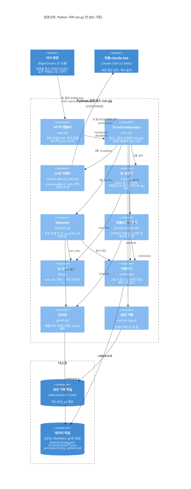

# C4 Component: Python 서버 안

- 갱신: 2026-10-25 (M2 끝, 커밋 `37952d8`). 최종 리뷰 수정 뒤 줄 번호를 커밋 `fea7dc3`에 맞췄다.
- C4 레벨 3. [C4 Container](c4-container.md)의 "Python 프로세스 `run.py`" 상자를 연다.
- "컴포넌트"는 C4 용어로 **한 컨테이너 안에서 따로 배포하지 않는 부품**이다. 이 앱에서는 `server/`의 파이썬 모듈 하나가 대개 컴포넌트 하나다.
- 한 턴이 이 부품들 사이를 시간 순서로 어떻게 지나가는지는 [한 턴 시퀀스(M2)](../sequences/turn-fastpath-m2.md)에 있다.

## 그림

- 상자는 선언한 순서대로 한 줄에 셋씩 놓인다. 그래서 부르는 쪽을 위에, 불리는 쪽을 아래에 적었다. 맨 윗줄(HTTP 핸들러, 턴 처리기, LLM 어댑터)이 한 턴의 큰 길이고, 둘째 줄(검증기, fastpath, 프롬프트)은 턴 처리기가 부르는 부품, 셋째 줄(id 규칙, 카탈로그, 단어장)은 그 부품들이 함께 쓰는 바탕이다.
- Mermaid의 C4 그림은 배치를 브라우저 창 폭이 아니라 **모니터 폭**(`screen.availWidth`)으로 정한다. 좁은 화면에서는 한 줄에 둘이나 하나씩 쌓이고 화살표 이름이 겹칠 수 있다. 그때는 아래 표를 기준으로 읽거나 "그림만 크게 보기"를 쓴다.
- 화살표는 부르는 방향(누가 누구를 쓰나)만 그렸다. 답은 같은 선으로 돌아온다. 아이 화면이 받아 가는 `catalog.json`은 서버가 읽는 바로 그 파일이다(HTTP 핸들러의 `/shared/`).

## 부품마다 하는 일

| 컴포넌트 | 파일 | 하는 일 | 대표 줄 |
|---|---|---|---|
| HTTP 핸들러 | `server/app.py` | 정적 파일(`/js/`, `/css/`, `/shared/`, `/docs/`)과 API. `/api/turn`은 턴 처리기가 내는 줄을 하나씩 쓰고 flush한다. 경로 탈출은 404 | `:46`–`51`(정적 폴더 표), `:161`–`183`(턴) |
| TurnOrchestrator | `server/turn.py` | 요청 검사, 한국어 판정, 잠금. LLM을 부르기 전에 1줄을 정하고(부화, fastpath), 2줄을 만든다(exact면 템플릿, 아니면 LLM). 세션의 부화 여부를 기억하되, 화면이 보낸 `dino.hatched: true`가 앞선다. partial 턴의 대체 답은 fastpath의 바른 문장 | `:256`–`274`(`handle`), `:276`–`284`(`_plan`), `:302`–`328`(`_ask`) |
| fastpath | `server/fastpath.py` | 단어 문장과 물건 문법으로 말을 ops로. exact/partial 판정, 템플릿 대사 | `:97`–`118`(`match`), `:288`–`330`(`_present`) |
| id 규칙 | `server/ids.py` | 새 물건 id `"{kind}{n}"`. fastpath와 검증기가 같이 쓴다 | `:23`–`37` |
| 답 검증기 | `server/reply.py` | LLM 글에서 JSON 하나 찾기, 필드마다 고치기, 카탈로그·장면·안전 규칙으로 ops 검사. 무엇이 와도 스키마에 맞는 답 | `:72`(`parse_reply_text`), `:90`(`validate_reply`), `:150`–`177`(통째로 버리는 경우), `:199`(`_OpsChecker`) |
| 프롬프트 만들기 | `server/prompt_builder.py` | 시스템 프롬프트의 `{VOCAB}`와 `{CATALOG}` 채우기, 턴 메시지 한 줄 JSON | `:63`(`vocab_lines`), `:69`(`catalog_summary`), `:88`(`build_turn_message`) |
| LLM 어댑터 | `server/llm/claude_agent.py`, `server/llm/fake.py` | `start_session`, `complete`, `end_session`. 진짜는 액터 스레드 하나가 `claude.exe`를 쥔다([ADR-0002](../adr/0002-stdlib-server-and-llm-actor.md)) | `server/llm/__init__.py:42`(프로토콜) |
| 단어장 | `server/words.py` | `content/words/*.json` 읽기와 검사(메모장의 UTF-8 BOM도 읽는다). `up_to(level)`, 물건·꾸밈말 표 | `:103`(`load_words`), `:88`(`up_to`) |
| 카탈로그 | `server/catalog.py` | `shared/catalog.json` 읽기와 검사. `actor_actions`, `is_food`, `can_color` 같은 질문 | `:39`(`Catalog`), `:83`(`load_catalog`) |
| 세션 기록 | `server/session_log.py` | 세션 시작, 턴, 세션 끝을 한 줄씩 | `:39`(`append`) |

그림에 넣지 않은 작은 부품 둘:
- `server/text.py`: 말 정리(`normalize`), 한글 판정(`has_hangul`), 군소리 판정(`FILLERS`). 턴 처리기, fastpath, 검증기가 같이 쓴다. fastpath는 말 앞뒤의 군소리를 뗀다.
- `server/canned.py`: 준비된 대사와 칭찬 차례(`praise`). 들린 말이 없을 때, LLM이 실패했을 때.

## 읽는 법

- **턴 처리기가 가운데다.** 다른 부품은 서로를 거의 모른다. fastpath는 LLM을 모르고, 검증기는 fastpath를 모른다. 둘이 아는 공통의 것은 카탈로그와 id 규칙뿐이다.
- **카탈로그 파일 하나를 셋이 본다.** fastpath와 검증기는 `catalog.py`로, LLM은 `prompt_builder.py`가 만든 요약으로, 아이 화면은 HTTP 핸들러가 내주는 같은 파일로 본다([ADR-0003](../adr/0003-turn-contract-and-catalog.md)).
- **서버는 장면을 쥐지 않는다.** 장면은 아이 화면이 턴마다 보낸다. 서버가 기억하는 것은 세션 id, 턴 수, 부화 여부뿐이다(`server/turn.py:199`–`201`). 부화 여부도 화면이 `hatched: true`라고 하면 그 말을 따른다(`server/turn.py:263`). 서버를 다시 켜도 열린 화면에 부화를 또 하지 않는다.
- **데이터 파일은 서버를 켤 때 한 번 읽는다**(`run.py:55`–`57`). 틀린 곳이 있으면 어느 파일의 무엇인지 담은 `ValueError`로 서버가 뜨지 않는다. 단어를 고친 뒤에는 서버를 다시 켠다.
- `--fake-llm`이어도 그림의 부품은 모두 똑같이 돈다. LLM 어댑터만 `FakeLLM`으로 바뀐다(`run.py:51`–`54`).

## 이 그림이 바뀌는 때

- M3: `redact`가 비밀 단어를 실제로 가린다(지금은 받은 그대로, `server/turn.py:68`). 가리기 부품이 턴 처리기 옆에 생긴다.
- M3: 한국어 도움 버튼(ko-KR)이 생기면 턴 요청에 언어가 실려 오고, 한국어 판정이 바뀐다.
- M5: 레벨 진행과 간격 반복이 들어오면 단어장 옆에 "아이가 배운 것" 부품이 생긴다.
