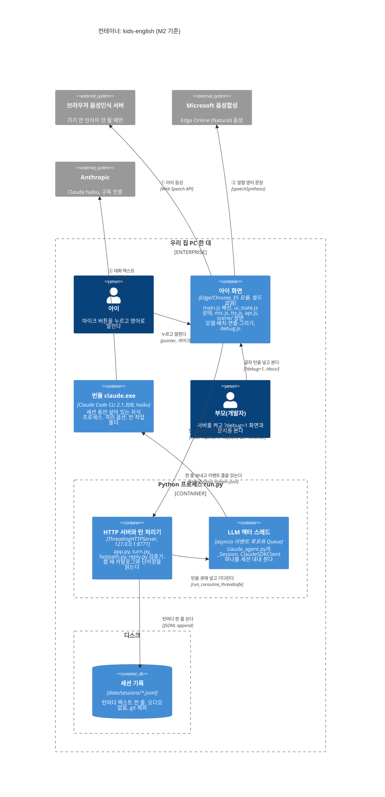

# C4 Container: kids-english 상자 안

- 갱신: 2026-10-25 (M1 끝, 커밋 `259ea1b`), 2026-10-25 (M2 끝, 커밋 `37952d8`: 장면 모듈, fastpath, 카탈로그와 단어장 파일을 더했다), 2026-10-25 (최종 리뷰 수정, 커밋 `fea7dc3`: 턴 끝내기 `web/js/turn_end.js`를 더했다)
- C4 레벨 2. [C4 Context](c4-context.md)에서 한 덩어리였던 `kids-english` 상자를 연다.
- "컨테이너"는 C4 용어로 **따로 돌아가는 실행 단위나 저장소**다. 도커 컨테이너와는 관계없다.
- 이 앱에서 실행 단위는 셋이다: 브라우저 화면, Python 프로세스(`run.py`), 그 자식 프로세스 `claude.exe`. 저장소는 `data/sessions/` 하나다.
- 한 턴이 이 상자들 사이를 시간 순서대로 어떻게 지나가는지는 [한 턴 시퀀스(M1)](../sequences/turn-m1.md)와 [한 턴 시퀀스(M2)](../sequences/turn-fastpath-m2.md)에 있다.

## 그림

- Mermaid의 C4 그림은 상자 배치를 브라우저 창 폭이 아니라 **모니터 폭**(`screen.availWidth`)으로 정한다. 폭이 1366 이상인 화면에서는 위 그림처럼 한 줄에 셋씩 놓인다.
- 좁은 화면이나 숨은 창에서는 상자가 한 줄에 하나씩 쌓이고 글자가 겹칠 수 있다. 그때는 아래 표를 기준으로 읽거나 "그림만 크게 보기"를 쓴다.

## 상자마다 하는 일

| 컨테이너 | 실행 단위 | 하는 일 | 코드 |
|---|---|---|---|
| 아이 화면 | 브라우저 탭(메인 스레드 하나) | 마이크로 듣고, 턴을 보내고, 답을 자막과 목소리로 낸다. 생각·말하는 중에는 마이크를 잠근다. (M2) 놀이판 장면을 쥐고 턴마다 보내며, ops를 장면에 적용해 그린다. 턴은 어떤 오류에도 답이나 대체 대사로 끝난다 | `web/js/main.js`, `web/js/turn_end.js`, `web/js/ui_state.js`, `web/js/mic.js`, `web/js/tts.js`, `web/js/api.js`, `web/js/ndjson.js`, (M2) `web/js/scene/*.js` |
| HTTP 서버와 턴 처리기 | `run.py` 프로세스의 HTTP 스레드(요청마다 하나) | 정적 파일과 API를 낸다. 턴 하나를 1줄(ack 또는 fast)과 reply 줄로 바꾼다. 턴은 잠금으로 하나씩 처리한다. (M2) 켤 때 `shared/catalog.json`과 `content/words/*.json`을 읽는다. 안쪽은 [C4 Component](c4-component-server.md) | `server/app.py`, `server/turn.py`, `server/reply.py`, (M2) `server/fastpath.py`, `server/ids.py`, `server/catalog.py`, `server/words.py`, `server/prompt_builder.py` |
| LLM 액터 스레드 | 같은 프로세스 안의 데몬 스레드(세션마다 하나) | asyncio 루프를 돌리며 `ClaudeSDKClient` 하나를 세션 내내 쥔다. 받은편지함 큐의 턴을 하나씩 `claude.exe`로 보낸다 | `server/llm/claude_agent.py` |
| 번들 `claude.exe` | 자식 프로세스(세션마다 하나, 상주) | stdin으로 받은 한 줄 메시지를 haiku에 보내고, stdout으로 이벤트 줄을 낸다. 사용자 설정·도구·플러그인 없이 돈다 | SDK 휠의 `claude_agent_sdk/_bundled/claude.exe`, 옵션은 `server/llm/claude_agent.py:77` |
| 세션 기록 | 파일 | 세션 시작·턴·세션 끝을 한 줄씩. 한글은 `\uXXXX`로 저장된다 | `server/session_log.py` |

## 읽는 법

- **점선 상자("우리 집 PC 한 대") 안**에는 사람(아이, 부모)과 앱의 모든 실행 단위가 있다. 이것들은 집에 있다. 집 밖으로 나가는 것은 바깥 회색 셋으로 가는 데이터 선 **①②③뿐**이다(이름과 뜻은 C4 Context와 같다).
- ②는 이제 어디서 나가는지가 보인다. 서버가 직접 나가는 것이 아니라, 서버가 띄운 `claude.exe`가 HTTPS로 Anthropic에 보낸다. ①과 ③은 서버를 거치지 않고 브라우저가 직접 보낸다.
- **"Python 프로세스" 상자 안에 둘을 나눠 그렸다.** C4의 엄밀한 뜻으로는 스레드는 따로 배포하는 단위가 아니라서 한 컨테이너다. 그래도 나눠 그린 이유는 M1의 핵심이 이 경계이기 때문이다. 왼쪽은 보통 함수 호출로 도는 **동기 세계**(HTTP 스레드), 오른쪽은 `async`/`await`로 도는 **비동기 세계**(액터의 이벤트 루프)다. 둘을 잇는 다리가 `run_coroutine_threadsafe`와 큐다([ADR-0002](../adr/0002-stdlib-server-and-llm-actor.md)).
- **`claude.exe`는 세션 동안 계속 살아 있다.** 턴마다 새로 띄우지 않는다. 띄우고 준비하는 데만 약 2초(bench 연결 1969 ms)가 들기 때문이다([ADR-0001](../adr/0001-local-claude-via-agent-sdk.md)).
- **"디스크" 점선 상자**는 실행 단위가 아니다. 세션 기록 파일이 프로세스 밖, 디스크에 있다는 표시다.
- 화살표는 요청 방향만 그렸다. 답은 같은 선으로 돌아온다(NDJSON 줄, stream-json 이벤트 줄, HTTPS 응답).

## 스레드와 프로세스 한눈에

| 어디서 | 몇 개 | 무엇이 돈다 | 막히면(기다리면) 무엇을 기다리나 |
|---|---|---|---|
| 브라우저 메인 스레드 | 1 | `main.js`의 `dispatch` → `render` → `runEffects` | 막히지 않는다. `fetch`와 `speechSynthesis`는 콜백·Promise로 돌아온다 |
| HTTP 핸들러 스레드 | 요청마다 1 (`ThreadingHTTPServer`) | `app.py _Handler._turn` → `TurnOrchestrator.handle` → `ClaudeAgentLLM.complete` | `complete` 안의 `.result(timeout=8.0)`에서 액터의 답을 기다린다 |
| 액터 스레드 | 세션마다 1 (새 세션이면 앞 것을 끝낸다) | `_Session._actor`: `async with ClaudeSDKClient` → `inbox.get()` → `_run_turn` | `await`로 기다리는 동안 루프는 SDK의 stdout 읽기 같은 다른 일을 한다 |
| `claude.exe` | 세션마다 1 | stream-json 대화. 대화 내용은 이 프로세스의 메모리에만 있다(`--no-session-persistence`) | Anthropic의 답 |

## 이 그림이 바뀌는 때

- M2(완료): 서버 상자에 카탈로그(`shared/catalog.json`), 단어장(`content/words/*.json`), fastpath가 더해졌다. reply 앞의 첫 줄이 `ack` 대신 `fast`(장면을 바로 바꾸는 줄)가 될 수 있다. 화면 상자에는 장면 모델과 배치(`web/js/scene/model.js`, `layout.js`), 연출(`director.js`), 놀이판 그리기(`render.js`)가 생겼다. 서버 안쪽은 [C4 Component](c4-component-server.md)에서 연다. 바깥 시스템은 그대로 셋이다.
- M3: 서버 상자의 `redact`가 비밀 단어를 실제로 가린다(지금은 받은 그대로 돌려준다, `server/turn.py:68`).
- 바깥 시스템이 늘면 [C4 Context](c4-context.md)와 함께 고친다.
