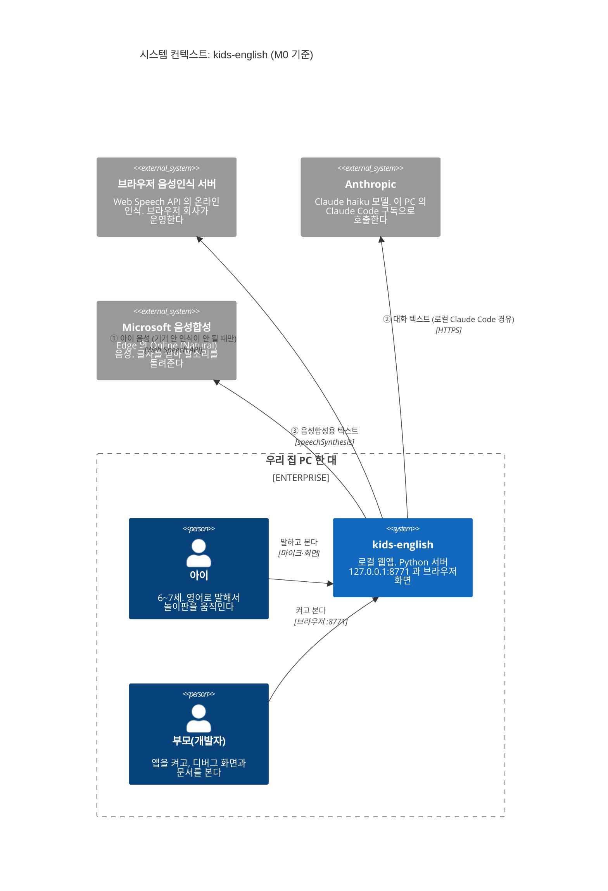

# C4 Context: kids-english와 그 바깥

- 갱신: 2026-10-22 (M0), 2026-10-25 (M1: 그림은 그대로, 설명과 표의 M1 항목만 고침)
- C4 레벨 1. 이 앱을 **한 덩어리 상자**로 보고, 누가 쓰고 어떤 바깥 시스템과 이야기하는지만 그린다.
- 상자 안쪽(서버, 브라우저 모듈, LLM 스레드)은 [C4 Container](c4-container.md)에서 연다.

## 그림

- 아이는 마이크로 영어를 말하고 화면의 놀이판을 본다. 부모는 브라우저에서 서버를 켜고 디버그 화면과 이 문서를 본다.
- Mermaid의 C4 그림은 화면(모니터) 폭에 맞춰 상자를 줄 바꿈한다. 휴대폰처럼 좁은 화면에서는 상자가 세로로 쌓이고 화살표 이름이 겹칠 수 있다. 그럴 때는 아래 표를 기준으로 읽는다.

## 읽는 법

- **점선 상자("우리 집 PC 한 대") 안**에는 아이, 부모, 그리고 앱 전체가 들어 있다. 이 사람들과 앱은 집에 있다. 집 밖으로 나가는 것은 그림에 그린 데이터 선(①②③)뿐이다.
- **상자 밖 회색 셋**이 바깥 시스템이다. 집 밖으로 나가는 선은 이 셋으로 가는 **①②③ 세 개뿐**이다. 화살표 이름이 곧 "무엇이 나가는가"다.
- 화살표는 데이터가 **나가는 방향**만 그렸다. 답(인식 결과, Claude 답, 말소리)은 같은 선으로 돌아온다.

## 집 밖으로 나가는 데이터 (spec 7절)

| # | 무엇이 | 어디로 | 언제 | 우리가 하는 일 |
|---|---|---|---|---|
| ① | 아이 음성 | 브라우저 음성인식 서버 | 브라우저가 기기 안에서 인식하지 못할 때만 | `mic.js`가 지원하면 기기 안 인식(`processLocally`)을 쓴다. 실제로 쓴 엔진을 디버그 화면에 보인다(M1에서 만듦) |
| ② | 대화 텍스트(아이가 한 말, 장면 상태) | Anthropic | LLM이 필요한 턴마다. fastpath가 정확히 맞춘 턴은 안 나간다(M2) | 로컬 Claude Code를 격리해서 부른다(spec 5.2). 비밀 단어는 보내기 전에 가린다(M3) |
| ③ | 캐릭터가 말할 영어 문장 | Microsoft | 캐릭터가 말할 때마다 | 브라우저 `speechSynthesis`가 Edge의 온라인 음성으로 보낸다. 목소리가 없으면 자막만 보인다 |

**나가지 않는 것**
- 녹음 파일. 오디오는 어디에도 저장하지 않는다.
- 세션 기록 `data/sessions/*.jsonl`(텍스트), 비밀 단어 목록 `data/private/blocklist.txt`. 둘 다 이 PC에만 있고 git에서도 빠진다(`.gitignore`).
- 아이 화면(`web/`)은 CDN, 웹폰트, 외부 이미지를 쓰지 않는다. CDN은 이 문서 뷰어(`docs/index.html`)만 쓴다.

**주의할 점**
- ①은 브라우저마다 운영 회사가 다르다(Edge는 Microsoft, Chrome은 Google). 그래서 그림에는 회사 이름 대신 "브라우저 음성인식 서버"라고 적었다.
- ③은 Edge의 "Online (Natural)" 음성을 고른다는 전제다(`web/js/tts.js:7`의 `pickVoice`, M1). 다른 브라우저에서 온라인 음성을 고르면 그 브라우저 회사로 간다.

## 이 그림이 바뀌는 때

- M1(완료): 상자 안을 여는 [`c4-container.md`](c4-container.md)가 생겼다(브라우저 모듈, Python 서버, LLM 액터 스레드, 번들 `claude.exe`, `data/`). 바깥 시스템은 그대로 셋이다.
- M3: 비밀 단어 가리기가 들어가면 ② 설명에 "가린 뒤"가 실제 동작이 된다.
- 바깥 시스템이 하나라도 늘면 이 그림과 spec 7절, `CLAUDE.md`의 "외부로 나가는 데이터" 문단을 함께 고친다.
