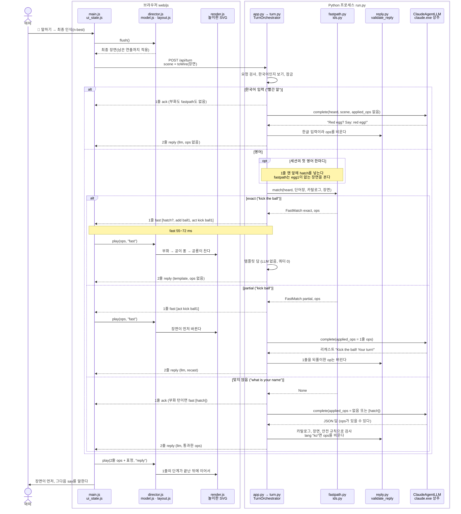

# 한 턴 시퀀스 (M2: fastpath와 LLM 두 줄)

- 갱신: 2026-10-25 (M2 끝, 커밋 `37952d8`). 최종 리뷰 수정 뒤 다시 맞췄다: **아래 줄 번호는 모두 커밋 `fea7dc3`의 실제 줄이다.**
- 아이가 말한 순간부터 장면이 바뀌고 멍멍이가 말할 때까지를 시간 순서로 그린다. M1의 그림([한 턴 시퀀스(M1)](turn-m1.md))은 LLM 한 갈래였다. M2에서는 서버가 LLM을 부르기 **전에** 말을 단어장과 맞춰 보고, 그 결과에 따라 갈래가 넷으로 나뉜다.
- 서버 안의 상자 구조는 [C4 Component(서버 안)](../architecture/c4-component-server.md), 규칙의 "왜"는 [ADR-0003](../adr/0003-turn-contract-and-catalog.md)(턴 계약)과 [ADR-0004](../adr/0004-fastpath.md)(fastpath), 화면 쪽 "같은 상태면 같은 그림"은 [M2 워크스루](../walkthrough/m2-speak-to-build.md)에 있다.
- M1에서 그린 부분(세션 열기, 액터 스레드와 `claude.exe` 사이의 stream-json, 8초 시간 초과)은 그대로라 여기서는 `ClaudeAgentLLM` 상자 하나로 줄였다.

## 그림 속 숫자는 어디서 왔나

| 표시 | 값 | 출처 |
|---|---|---|
| fast 줄 | 55–72 ms (`127.0.0.1`) | Task 15 미리보기 실측, 실제 Claude, 브라우저가 보낸 때부터 |
| ack 줄 | 8–59 ms | 같은 실측 |
| 서버 안의 시간 | 0–1 ms (`total_ms`) | 같은 실측. `match` 한 번은 약 55–100 µs(Task 11) |
| template 2줄 | fast 줄 바로 뒤(예: fast 72 ms, reply 76 ms) | 같은 실측, 첫 턴 `kick the ball` |
| LLM 2줄 | p50 2.7초, 최대 3.4초 (n=5) | 같은 실측. M1 bench는 p50 1.9초였다([ADR-0004](../adr/0004-fastpath.md)의 "LLM 지연") |
| 연출 | 부화 1100 ms, 물건 450 ms, 동작 800 ms 간격 | `web/js/scene/director.js:15`–`17` |
| 말하기 전 기다림 | 장면 연출이 다 시작될 때까지, 최대 1.6초 | `web/js/main.js:26`, `:227` |

## 그림



- **겉의 `alt`(한국어 / 영어)는 서버가 LLM을 부르기 전에 정한다.** 기준은 군소리를 뺀 첫 인식 후보에 한글이 있는가다. 이 판정은 디버그 글자 입력에서만 일어난다. 실제 음성은 en-US 인식기 하나라 한국어가 엉뚱한 영어 글자로 온다. 그 말은 대개 "맞지 않음" 갈래로 가고, LLM이 `utterance.lang: "ko"`라고 답하면 검증기가 ops를 비운다(spec 4절).
- **`opt`(부화)는 영어 갈래 셋 모두에 붙는다.** 세션의 첫 영어 한마디면 무엇을 말했든 알이 깨진다. 맞지 않는 말이어도 1줄은 ack가 아니라 `fast [hatch]`다. 단, 화면이 보낸 장면의 공룡 줄이 `"hatched": true`면(이미 깨어난 화면, 예: 서버를 다시 켠 뒤) `opt`는 일어나지 않는다(`server/turn.py:159`, `:263`).
- **안쪽 `alt`의 세 갈래**가 [ADR-0004](../adr/0004-fastpath.md)의 판정이다. exact만 LLM을 건너뛴다.
- **2줄의 ops는 1줄의 연출이 끝난 뒤에 나온다.** 연출은 줄을 서서 차례로 적용된다(`web/js/scene/director.js:108`–`116`). 멍멍이는 장면이 먼저 바뀐 것을 보여 준 뒤 말한다.

## 단계마다 코드

| 단계 | 무슨 일 | 코드 |
|---|---|---|
| 요청 만들기 | 남은 연출과 쉬는 자세까지 지금 적용하고(`flush`), 그 장면을 요청 모양으로 바꾼다 | `web/js/main.js:204`–`212`, `web/js/scene/director.js:117`–`133`, `web/js/scene/model.js:52`–`67` |
| 요청 검사 | 후보 5개까지, 군소리 빼기, 한국어 판정(가리기 전에), 장면 40개까지 | `server/turn.py:137`–`160` (한국어 `:153`–`154`) |
| 잠금 | 한 번에 한 턴 | `server/turn.py:260` |
| 1줄 정하기 | 들린 말이 없음·한국어·카탈로그 없음이면 아무것도 없음. 아니면 부화 + fastpath | `server/turn.py:276`–`284` |
| 부화 | 화면이 아직 안 깨어났으면 `hatch`를 맨 앞에, fastpath에는 `egg1`을 뺀 장면(+ id만 남긴 자리) | `server/turn.py:64`, `:263`, `:279`–`283` |
| fastpath | n-best를 앞에서부터, 처음 맞는 후보 | `server/fastpath.py:97`–`118` |
| 1줄 내보내기 | `fast`(ops 있음) 또는 `ack` | `server/turn.py:106`–`109`, `:264`, `server/app.py:177` |
| exact | 템플릿 답. `say`, `korean_hint`는 단어장에서, ops는 비움 | `server/turn.py:305`–`307`, `:350`–`374` |
| partial / 맞지 않음 / 한국어 | 턴 메시지에 `applied_ops` = 1줄 ops, LLM 호출 | `server/turn.py:308`–`311`, `server/prompt_builder.py:88`–`108` |
| 검증 | 카탈로그, 받은 그대로의 장면, 1줄 ops로 검사 | `server/turn.py:320`–`322` → `server/reply.py:90`–`144` |
| 2줄 ops 자르기 | LLM의 `hatch` 빼기, 1줄과 합쳐 4개까지 | `server/turn.py:327`, `:330`–`339` |
| LLM 실패 | 시간 초과·오류·JSON 아님. partial이면 fastpath의 바른 문장으로 | `server/turn.py:312`–`318`, `:341`–`346` |
| 2줄 내보내기 | `reply`, `source`와 `latency` | `server/turn.py:274` |
| 화면: fast 줄 | 효과음 "퐁", 연출에 넘기기 | `web/js/main.js:218`–`221` |
| 화면: 연출 | 단계마다 `applyOps` → 그리기 | `web/js/scene/director.js:63`–`71`, `web/js/main.js:85`–`90`, `:101`–`103` |
| 화면: reply 줄 | ops와 표정을 연출에 넘기고, 연출이 다 시작되면(최대 1.6초) 말하기 | `web/js/main.js:222`–`231` |
| 화면: reply가 안 옴 | 브라우저가 "Hmm! Let's try that again!"(답을 보이다 오류가 나도 같다) | `web/js/main.js:239`–`243`, `web/js/turn_end.js` |

## 선 위에서 실제로 보이는 것

`--fake-llm` 서버(포트 8773)에 보낸 실제 응답이다(2026-10-25, 쿼터 0). fastpath, 부화, 검증기는 진짜와 똑같이 돌고, LLM의 답만 FakeLLM의 준비된 한 줄이다(`run.py:29`–`43`).

**첫 턴 "kick the ball"** (처음 화면: 둥지 속 알). 1줄에 부화, 공 만들기, 차기가 함께 온다. 2줄은 template이고 `llm_ms`가 `null`이다.

```text
{"kind": "fast", "turn_id": 1, "ops": [{"op": "act", "actor": "dino", "action": "hatch"}, {"op": "add", "kind": "ball", "id": "ball1", "count": 1}, {"op": "act", "actor": "dino", "action": "kick", "target": "ball1"}], "sfx": "pop"}
{"kind": "reply", "turn_id": 1, "source": "template", "say": "Excellent! Kick the ball!", "recast": null, "choice": null, "korean_hint": "공을 차 → Kick the ball!", "ops": [], "mood": null, "utterance": {"lang": "en", "words_used": ["kick-the-ball"], "errors": []}, "latency": {"llm_ms": null, "total_ms": 3}}
```

**"kick ball"** (공룡이 깨어 있고 `ball1`이 있는 장면). partial이라 1줄이 장면을 바꾸고 2줄은 LLM이다. FakeLLM이라 리캐스트 대신 준비된 인사를 했다. 진짜 Claude는 Task 15에서 "Wow, so far! Kick the ball! Your turn!"이라고 답했다.

```text
{"kind": "fast", "turn_id": 2, "ops": [{"op": "act", "actor": "dino", "action": "kick", "target": "ball1"}], "sfx": "pop"}
{"kind": "reply", "turn_id": 2, "source": "llm", "say": "Good job! I'm Chomp. Let's play!", ...}
```

**"빨간 알"** (한국어). 1줄은 ack, 장면은 그대로다.

```text
{"kind": "ack", "turn_id": 3}
{"kind": "reply", "turn_id": 3, "source": "llm", "say": "Excellent! I'm Chomp. Let's play!", ..., "ops": [], ...}
```

- 한글이 `공`처럼 보이는 것은 줄을 ASCII로만 쓰기 때문이다(`server/app.py:35`). 브라우저의 `JSON.parse`가 다시 한글로 읽는다.
- `korean_hint`의 화살표 `→`는 "→"다. "공을 차 → Kick the ball!"

## M3에서 바뀌는 곳

- LLM 갈래가 느리다(p50 2.7초). 시스템 프롬프트를 줄이고 다시 잰다([ADR-0004](../adr/0004-fastpath.md)). 그래도 넘으면 2줄을 기다리지 않고 `say`가 도착하는 대로 말하게 바꾼다. 그때 이 그림의 2줄이 "say 조각"과 "나머지"로 나뉜다.
- 한국어 도움 버튼(ko-KR 인식)이 생기면 겉의 `alt` 한국어 갈래가 실제 음성에서도 일어난다.
- "Did you say X or Y?" 확인이 "맞지 않음" 갈래 안에 생긴다.
