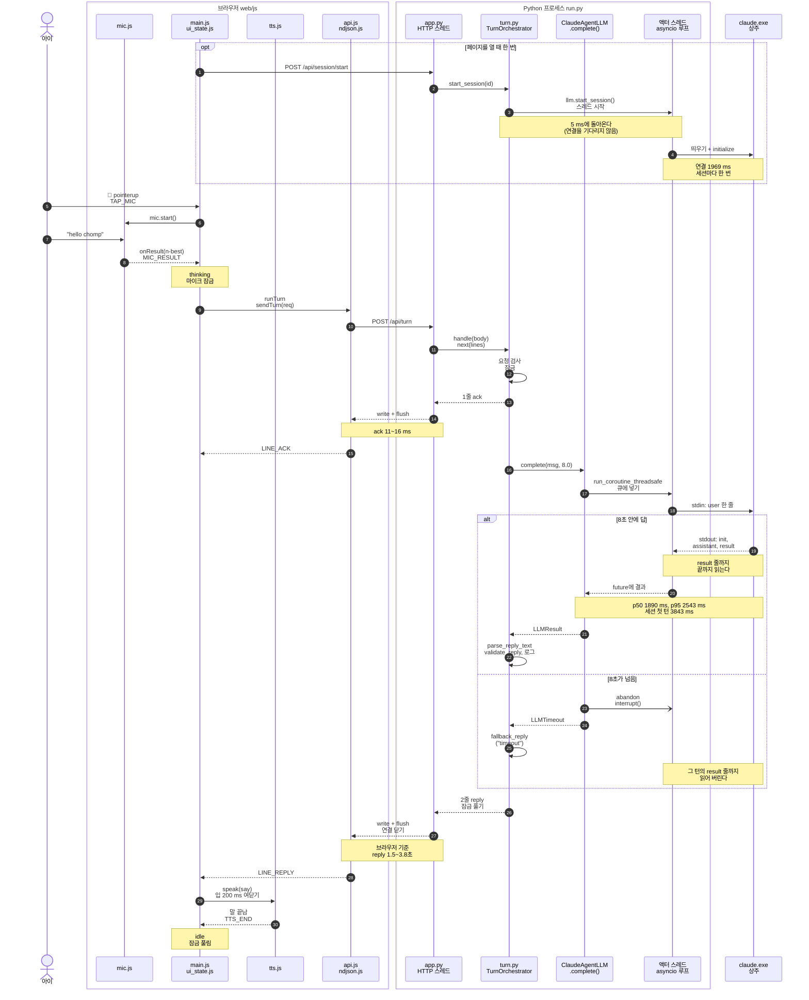

# 한 턴 시퀀스 (M1)

- 갱신: 2026-10-25 (M1 끝, 커밋 `259ea1b` 기준)
- 아이가 🎤를 누르고 "hello chomp"라고 말한 순간부터 멍멍이가 말을 끝낼 때까지를 시간 순서로 그린다.
- 상자 구조는 [C4 Container](../architecture/c4-container.md), 이 흐름의 "왜"는 [M1 워크스루](../walkthrough/m1-walking-skeleton.md)에 있다.

## 그림 속 숫자는 어디서 왔나

| 표시 | 값 | 출처 |
|---|---|---|
| 세션 연결 | `start_session` 반환 5 ms, `claude.exe` 띄우기 + initialize 1969 ms | Task 4 bench (`scripts/bench_llm.py --turns 20`, 2026-10-24) |
| LLM 한 턴 | p50 1890 ms, p95 2543 ms, 최소 1548, 최대 3843(세션 첫 턴, 콜드), 평균 1986 | 같은 bench, 20턴 |
| ack 줄 | 11–16 ms (LLM 턴), 6 ms (빈 턴) | Task 7 미리보기 실측. 브라우저가 보낸 때부터 ack 줄을 받을 때까지 |
| reply 줄 | 3756 ms(첫 턴), 2036 ms, 1533 ms | Task 7 미리보기 실측 3턴. 브라우저 기준 |
| 서버 안 파싱·검증 | 1 ms 미만 | Task 7 첫 턴의 reply 줄: `llm_ms=3746`, `total_ms=3746` |
| M1 마일스톤 재확인 | ack 12 ms, reply 2419 ms (`llm_ms=2413`, `total_ms=2414`, 세션 첫 턴) | Task 8 미리보기 `?debug=1` "hello chomp" 1턴, 2026-10-25 |

- bench의 지연(`latency_ms`)은 `complete()`를 부른 때부터 답이 올 때까지다. 큐에서 기다린 시간과 stream-json 왕복이 모두 들어 있다(`server/llm/claude_agent.py:418`, `:435`).
- 아이가 말을 끝낸 뒤 브라우저가 최종 인식 결과를 내기까지 걸리는 0.5~1초는 브라우저 몫이라 재지 않았다(spec G1).

## 그림



## 화살표 번호로 따라가기

| 번호 | 무슨 일 | 코드 |
|---|---|---|
| 1–3 | 페이지를 열면 세션을 연다. 서버는 `claude.exe`를 띄우기 **시작만** 하고 바로 답한다 | `web/js/main.js:56`, `web/js/api.js:25`, `server/turn.py:134`, `server/llm/claude_agent.py:386` |
| 4 | 액터 스레드가 `async with ClaudeSDKClient`로 연결한다. 이 `async with` 블록이 세션 내내 이어진다 | `server/llm/claude_agent.py:247` |
| 5–8 | 탭하면 듣고, 최종 결과가 오면 리듀서가 thinking으로 바꾼다(이때부터 탭을 무시한다) | `web/js/main.js:221`, `:84`, `:47`, `web/js/ui_state.js:51`–`52` |
| 9–10 | 턴 요청을 보낸다. M1에서는 `scene: []`, `hint_requested: false` | `web/js/main.js:88`, `:149`, `web/js/api.js:37` |
| 11–14 | 요청 검사 → 잠금 → **LLM을 부르기 전에** ack 줄을 내보낸다 | `server/app.py:161`–`177`, `server/turn.py:179`–`181` |
| 15 | 브라우저는 줄이 올 때마다 `onLine`을 부르고, ack 줄은 상태를 바꾸지 않는다 | `web/js/api.js:47`, `web/js/ndjson.js:14`, `web/js/main.js:165` |
| 16–17 | 동기 세계(HTTP 스레드)에서 비동기 세계(액터 루프)로 턴을 넘기고 `.result(timeout)`으로 기다린다 | `server/turn.py:203`, `server/llm/claude_agent.py:420`, `:424` |
| 18–19 | 액터가 한 줄 메시지를 stdin에 쓰고, stdout의 이벤트 줄을 ResultMessage까지 읽는다 | `server/llm/claude_agent.py:289`, `:295` |
| 20–21 | 액터가 future에 답을 넣으면 기다리던 HTTP 스레드가 깨어난다 | `server/llm/claude_agent.py:273`, `:435` |
| 22 | 어떤 글이 와도 스키마에 맞는 답으로 고친다. 첫 후보에 한글이 있으면 `ops`를 비운다 | `server/turn.py:211`–`213` |
| 23–25 (else) | 시간 초과면 그 턴을 포기하고 interrupt를 보낸다. 서버는 준비된 대사로 답한다 | `server/llm/claude_agent.py:425`–`428`, `:330`, `server/turn.py:204`–`210` |
| 26–27 | reply 줄을 쓰고 연결을 닫는다(HTTP/1.0이라 닫는 것이 "끝" 신호) | `server/turn.py:188`, `server/app.py:178`–`179` |
| 28–30 | 자막을 바꾸고 목소리로 말한다. 영어 목소리가 없으면 조용히 넘어가고 자막만 남는다 | `web/js/main.js:169`, `:90`–`96`, `web/js/tts.js:62` |

- 번호는 Mermaid가 화살표에 붙이는 번호다(Note는 세지 않는다). `alt`의 두 갈래도 이어서 센다. 그래서 위쪽 갈래(답이 옴)는 19–22, 아래쪽 갈래(시간 초과)는 23–25다.
- 서버에 닿지 못하거나 reply 줄이 오지 않아도 화면은 멈추지 않는다. 브라우저가 "Hmm! Let's try that again!"으로 대신 답한다(`web/js/main.js:176`).

## 선 위에서 실제로 보이는 것

`/api/turn`의 응답 본문은 줄 두 개다. 아래는 `--fake-llm` 서버에 `curl`로 보낸 실제 응답이다(2026-10-25). 진짜 Claude여도 모양은 같고 `say`와 지연만 다르다.

```text
{"kind": "ack", "turn_id": 1}
{"kind": "reply", "turn_id": 1, "source": "llm", "say": "Good job! I'm Chomp. Let's play!", "recast": null, "choice": null, "korean_hint": "\uac19\uc774 \ub180\uc790! \u2192 Let's play!", "ops": [], "mood": null, "utterance": {"lang": "en", "words_used": [], "errors": []}, "latency": {"llm_ms": 0, "total_ms": 0}}
```

- 한글이 `\uac19`처럼 보이는 것은 줄을 ASCII로만 쓰기 때문이다(`server/app.py:35`). 브라우저의 `JSON.parse`가 다시 한글로 읽는다.
- 들린 말이 없으면(빈 n-best) LLM을 부르지 않고 `"source": "template"`, `"llm_ms": null`로 답한다.

## M2에서 바뀌는 곳

- 첫 줄이 fastpath 결과면 `{"kind":"fast","ops":[...]}`가 되고, 화면이 LLM 답을 기다리지 않고 장면을 먼저 바꾼다. 그 그림은 `docs/sequences/turn-fastpath-m2.md`(Task 16)에 그린다.
- 턴 요청의 `scene`이 빈 목록이 아니라 지금 놀이판 상태가 된다.
