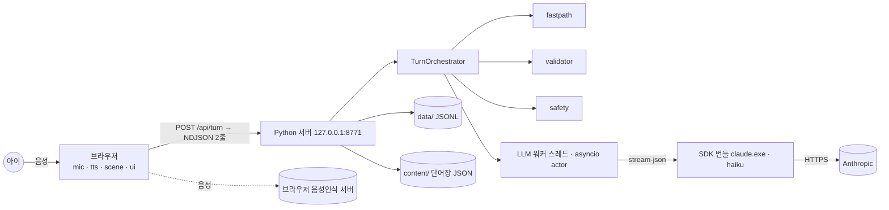

# kids-english 설계: "말하면 세상이 바뀐다"

- 작성: 2026-10-22
- 상태: 초안 (사용자 승인 대기)
- 관련 문서: [알레프키즈 벤치마킹](../../benchmark/aleph-kids.html) · [슈니비니 벤치마킹](../../benchmark/shunibini.md) · 승인된 실행 계획 `~/.claude/plans/ancient-foraging-stallman.md`

---

## 1. 무엇을, 왜 만드는가

아이(6~7세)의 **영어 말하기**를 키우는, 우리 집 전용 놀이 앱이다.

**알레프키즈에서 가져올 것과 다르게 할 것**
- 알레프키즈는 마인크래프트 안 AI 친구와 음성으로 대화하는 서비스다.
- 가져올 원리: 아이가 이미 하고 싶은 놀이 안에서, 지금 눈앞의 것에 대해 말하게 한다.
- 고칠 약점: 알레프키즈에서는 영어가 덧붙은 장치라 말을 안 해도 게임이 계속된다.
- 그래서 이 앱에서는 **영어 한마디가 곧 조종 버튼**이다. 영어로 말해야만 놀이판이 움직인다.

**아이와 놀이판**
- 아이는 한글을 잘 읽는다.
- 마리오의 체인 촘프인 **"멍멍이"**(강아지 아님)와 공룡을 좋아한다.
- 집에 슈니비니 **액션카드 A·B와 퀴즈카드**가 있고, 거기 나온 표현을 조금 말해 본 적이 있다.
- 놀이판에는 멍멍이와 **아기 공룡**이 있다. 아이가 "Turn around!", "Kick the ball!", "Big red egg!"처럼 말하면 캐릭터가 움직이고 물건이 생긴다.

**장기 목표 (사용자 요청)**
- 슈니비니 동작 표현 전부와, 말하기에 필요한 핵심 단어를 **최대한 많이** 익힌다. 목표 규모는 700~900개.
- 이를 위해 단어는 코드가 아니라 데이터로 계속 늘어나게 설계한다.

**사용자(부모)의 목표**
- 사용자는 개발자다. 구조를 **이해하면서** 만들고 싶어 한다.
- 그래서 마일스톤마다 아키텍처·시퀀스 다이어그램과 워크스루 문서를 남긴다. 결과물만큼 사용자의 이해가 중요하다.

## 2. 목표 / 비목표 / 반목표

**목표**
- G1. 아이가 영어로 말하면 놀이판이 바로 반응한다. 지연은 모두 **음성인식 최종 결과가 나온 시점부터** 잰다(⚙️ 빌더 결정, 아래 지연 예산 참고).

| 반응 | 목표 |
|---|---|
| 생각 중 애니메이션 | 0.1초 이내 |
| fastpath 장면 변화 | 0.5초 이내 |
| LLM 대사 | p50 2.5초 이하, p95 4초 이하 |
| 대체 대사로 넘어가는 시점 | 8초 |

  - 아이가 말을 끝낸 뒤 Web Speech가 결과를 확정하는 데 0.5~1초가 걸린다. 이 시간은 브라우저가 정하는 몫이라 측정에서 따로 기록만 한다.
  - M1의 bench 결과가 LLM 목표를 넘어도 **멈추지 않는다.** 숫자를 ADR-0001에 기록하고, 다음 대응 중 하나를 골라 보고한 뒤 계속 진행한다.
    1. fastpath가 맡는 범위를 넓힌다.
    2. 프롬프트를 줄인다.
    3. 응답에서 `say`를 먼저 읽어 바로 말하게 한다.
  - 멈추는 조건은 격리 확인 실패뿐이다.
- G2. 아이가 자기가 아는 표현(슈니비니)으로 첫 판부터 성공한다. 그다음 한 칸씩 새 단어로 넓힌다.
- G3. 추가 비용 0원. 이 PC의 Claude Code 구독(Haiku)과 브라우저 음성 기능만 쓴다.
- G4. 단어는 데이터 파일에 한 줄 추가하는 것만으로 늘어난다.
- G5. 마일스톤마다 사용자가 읽고 이해할 수 있는 워크스루 문서와 다이어그램이 남는다.

**비목표 (이번에 하지 않음)**
- 여러 아이나 여러 가족, 로그인, 배포. 우리 집 PC 한 대에서만 쓴다.
- 발음 점수 매기기. 아이 음성인식은 정확도가 낮아서, 점수가 오히려 해가 된다.
- 태블릿 지원. 마이크에 HTTPS가 필요해서 나중으로 미룬다.
- 유료 API 연결. 어댑터 자리만 남겨 둔다.

**반목표 (동작은 해도 이렇게 되면 실패)**
- A1. 아이가 "틀렸다"는 느낌을 받는다. "Wrong", "No" 같은 말, 게임오버, 감점은 절대 없다.
- A2. 한국어 번역에 기대서 영어를 안 한다. 한국어 힌트는 요청할 때만 보인다.
- A3. 아이 대화용 Claude가 놀이 밖 이야기로 새거나, 부적절한 말을 한다.
- A4. 개발용 설정(Explanatory 출력 스타일, superpowers, claude.ai 커넥터)이 아이 대화에 섞인다.
- A5. 문서가 코드보다 늦어져서 사용자가 구조를 따라가지 못한다.

## 3. 제약

- Windows 11, Edge 155 / Chrome 155, Python 3.13, Node 24.
- 프로젝트 경로는 `kids-english/`. 경로에 한글과 공백이 있다.
- 스택은 **Python 표준 라이브러리 HTTP 서버 + 순수 HTML/CSS/JS**. 프레임워크와 빌드 도구는 쓰지 않는다. 외부 Python 의존성은 `claude-agent-sdk` 하나다(개발용으로 pytest, jsonschema 추가).
- LLM은 **로컬 Claude Code(구독), 모델 haiku**. API 키는 쓰지 않는다.
- 음성 입력은 브라우저 Web Speech API(en-US), 음성 출력은 브라우저 speechSynthesis.
- 서버는 127.0.0.1:8771에만 연다.
- 아이 UX 규칙은 `kids-games/CLAUDE.md`를 따른다.
  - 버튼은 최소 120px, 글씨는 최소 28px.
  - pointer 이벤트를 쓰고 키보드 조작은 쓰지 않는다.
  - 무서운 것, 때리기, 게임오버가 없다.
  - 멍멍이가 덥석 무는 것은 음식·간식·코인만이다.
  - 1초에 3번 넘게 깜빡이는 효과를 쓰지 않는다.
  - 효과음은 Web Audio로 만든다.
- 멍멍이는 공식 그림을 쓰지 않고 SVG로 직접 그린다. 기본 모습은 `kids-games/index.html` 94–110행이고, 개인·비상업 팬아트로만 쓴다. 화면에 영어 호칭이 필요하면 "Chomp"라고 쓴다.

## 4. 아이가 겪는 화면 (M2 기준)

```
┌──────────────────────────────────────────────┐
│  🏠                          ☀️        (?)    │  ← (?) = 한국어 힌트 요청
│                                              │
│      🌳        [멍멍이]      [아기 공룡]       │  ← 놀이판(SVG)
│   🪺(알)                ⚽                    │
│                                              │
│   💬 "Kick the ball! Wow, so far!"           │  ← 캐릭터 대사(영어 자막, 크게)
│                                              │
│                  ( 🎤 )                       │  ← 큰 말하기 버튼(지름 160px 이상)
└──────────────────────────────────────────────┘
```

**한 턴의 흐름**
1. 아이가 🎤를 한 번 누르고 말한다. 말이 끝나 조용해지면 자동으로 끝난다.
2. 들은 말이 화면에 잠깐 보인다.
3. 아는 명령이면 0.5초 안에 캐릭터가 움직인다(fastpath).
4. 이어서 캐릭터가 영어로 짧게 반응한다. 아이 말이 틀렸으면 바른 문장으로 고쳐 말해 준다(리캐스트).
5. 캐릭터가 말하는 동안에는 마이크를 잠근다(자기 목소리를 다시 인식하지 않도록).

**캐릭터 역할**
- **멍멍이:** jump, chomp(음식만), bark, spin, hide → "Here I am!", sleep
- **아기 공룡:** 팔다리가 있는 동작 담당. 슈니비니의 몸 동작(turn around, walk, kick, stretch your arms, fold your arms, thumbs up, climb up, yawn, sneeze, clap, dance…)과 옷 입기(put on your socks).
- **첫 화면:** 둥지 속 알 하나. 세션에서 처음 영어로 말하면 알이 부화해 아기 공룡이 나온다.

**한국어로 말하거나 알아듣기 어려울 때** (⚙️ 빌더 결정, "영어 한마디가 곧 조종 버튼" 원칙과 반목표 A2를 따름)

- **한국어 입력이면 장면은 바꾸지 않는다.** 대신 캐릭터가 영어로 따라 할 문장을 준다.
  - 예: "빨간 알" → `ops` 없음, `say`: "Red egg? Say: red egg!"
  - 검증기는 `utterance.lang=="ko"`인 답에서 `ops`를 비운다.
  - 아이가 그 영어 문장을 말하면 그때 장면이 바뀐다.
- **실제 음성의 경우:** `mic.js`는 en-US 인식기 하나만 쓴다. 아이가 한국어로 말하면 엉뚱한 영어나 빈 결과가 온다. 이것은 "알아듣기 어려움"과 똑같이 처리한다.
  - 캐릭터가 영어 선택 질문("Kick or jump?")이나 따라 할 문장으로 받아 준다.
- **한국어 처리는 디버그 글자 입력으로만 검증한다(M2).** ko-KR로 인식하는 "🇰🇷 도와줘" 버튼은 M3에 넣는다.
- **(?) 힌트 버튼은 M2에 넣는다.**
  - 누르면 서버를 부르지 않고, 직전 답에 들어 있던 `korean_hint`를 말풍선 아래에 크게 보여 준다.
  - 다음 턴 요청에 `hint_requested:true`가 실려 기록된다.
  - `korean_hint`의 내용은 번역이 아니라 **"이렇게 말해 봐"**다. 아이가 다음에 말해 볼 영어 문장과 그 뜻을 함께 준다.
    - 예: `"공을 차 보자 → Kick the ball!"`
- **8초 동안 말이 없을 때 자동 힌트**와 **"Did you say X or Y?"** 확인은 M3에서 넣는다.

## 5. 아키텍처 (결정됨)

### 5.1 컨테이너



### 5.2 LLM 연결 (ADR-0001)

**연결 방식**
- `claude-agent-sdk==0.2.172`의 `ClaudeSDKClient` 하나를 **세션 동안 살려 두고**, 턴마다 메시지 한 줄을 보낸다.
- Windows 휠에 `claude.exe`가 들어 있어서 PATH 문제가 없다.
- `claude -p`를 턴마다 실행하면 3~7초가 걸려서 쓰지 않는다.
- `--bare` 모드는 구독 인증을 읽지 못해서 쓸 수 없다.

**격리 옵션 (반목표 A4)**

| 무엇을 막나 | 설정 |
|---|---|
| 기본 프롬프트 | `system_prompt`에 `prompts/chomp_system.md` 파일을 지정해 통째로 교체 |
| 내장 도구 | `tools=[]` |
| MCP 도구 | `disallowed_tools=["mcp__*"]`, `strict_mcp_config`, `mcp_servers={}` |
| 사용자 설정 전부 | `setting_sources=[]` (출력 스타일, CLAUDE.md, 훅, 스킬, 플러그인) |
| 그 밖 | `permission_mode="dontAsk"`, `max_turns=1` |
| 환경변수 | `CLAUDE_CODE_DISABLE_AUTO_MEMORY=1`, `CLAUDE_CODE_DISABLE_CLAUDE_MDS=1`, `ENABLE_CLAUDEAI_MCP_SERVERS=false` 등 |
| 대화 기록 저장 | `--no-session-persistence` |
| 작업 폴더 | 비어 있는 ASCII 임시 폴더(`%TEMP%\kids_english_llm`) |

- 사고 과정(thinking)을 끄는 옵션은 SDK가 지원하면 쓴다.
- 서버를 시작할 때 `ANTHROPIC_API_KEY`를 환경에서 지운다. 실수로 API 요금이 나가지 않게 하기 위해서다.

**인증**
- 기본: 이미 로그인된 구독 자격증명.
- 선택: 사용자가 직접 `claude setup-token`으로 받은 토큰을 `.env`의 `CLAUDE_CODE_OAUTH_TOKEN`에 넣으면 그 토큰을 우선 쓴다. 이 토큰에는 claude.ai 커넥터가 따라오지 않아 더 안전하다.
- **토큰 입력은 사용자가 직접 한다.**

**M1에서 확인할 것**
- `scripts/bench_llm.py`로 측정한다.
  - 세션 시작 메시지(`init`)의 `tools`, `mcp_servers`, `plugins`가 비어 있는지
  - `model`이 haiku인지
  - 20턴 지연의 p50/p95
- 결과를 ADR-0001에 기록한다.
- 격리 확인에 실패하면 구현을 멈추고 사용자에게 보고한다.

### 5.3 서버 동시성 (ADR-0002)

- `ThreadingHTTPServer`를 쓴다. LLM 전용 스레드 하나가 asyncio 이벤트 루프를 돌리며 `ClaudeSDKClient`를 쥐고, 큐로 들어온 요청을 차례로 처리한다.
- HTTP 핸들러는 `run_coroutine_threadsafe(...).result(timeout)`로 이 스레드를 호출한다.
- 이렇게 하는 이유: SDK는 연결부터 종료까지 같은 async 컨텍스트 안에서 처리해야 한다. 아이는 한 명이라 턴이 동시에 들어올 일이 없다.

### 5.4 LLM 어댑터

```python
class LLM(Protocol):
    def start_session(self, system_prompt: str) -> None   # 미리 띄우기, 기다리지 않음
    def complete(self, user_msg: str, timeout_s: float) -> LLMResult  # text, latency_ms, model
    def end_session(self) -> None
```

| 구현체 | 용도 |
|---|---|
| `FakeLLM` | 테스트용. 미리 정한 답, 일부러 지연, 깨진 JSON을 재현 |
| `ClaudeAgentLLM` | 실제 사용 |
| `AnthropicApiLLM` | 나중에 유료 API로 바꿀 자리. 지금은 만들지 않음 |

### 5.5 턴 계약 (ADR-0003)

**요청: 브라우저 → `POST /api/turn`**

```json
{"session_id":"2026-10-22_1905","turn_id":17,
 "asr":{"engine":"webspeech","lang":"en-US",
        "alternatives":[{"t":"kick the ball","c":0.71},{"t":"kick a ball","c":0.52}]},
 "hint_requested":false,
 "scene":[{"id":"dino","kind":"dino","state":"idle"},{"id":"ball1","kind":"ball","color":"red","size":"big"}]}
```

**LLM 출력**
- 서버가 검증하는 JSON 하나만 출력하게 한다.
- `say`를 첫 키로 둔다(나중에 앞부분부터 먼저 읽게 할 대비).

```json
{"say":"Yes! Kick the ball! Wow, so far!",
 "recast":null,
 "choice":null,
 "korean_hint":"공을 차!",
 "ops":[{"op":"act","actor":"dino","action":"kick","target":"ball1"}],
 "mood":{"actor":"chomp","face":"excited"},
 "utterance":{"lang":"en","words_used":["kick-the-ball"],"errors":[]}}
```

**`ops` 규칙**
- 종류는 `add` / `set` / `move` / `remove` / `act` 다섯 가지다.
- 한 턴에 최대 4개까지만 허용한다.
- 물체 종류, 색, 크기, 개수, 위치, 동작은 모두 `shared/catalog.json`에 있는 값만 쓸 수 있다.
- **LLM은 SVG나 HTML을 절대 만들지 않는다.**

**`say` 규칙**
- 15단어 이하.
- 한글 금지. 한글은 `korean_hint` 필드에만 쓸 수 있다.
- `<` 문자와 URL 금지.

**서버 처리**
- `validator.py`가 위 규칙을 어기는 부분을 걸러 낸다.
- JSON이 깨졌거나 8초 안에 답이 없으면 준비된 대사(`canned.py`)로 대신 답한다.
- 어떤 경우에도 놀이는 멈추지 않는다.

**응답: NDJSON 두 줄**
1. 30ms 안에 보내는 첫 줄: `{"kind":"fast","ops":[...],"sfx":"pop"}` 또는 `{"kind":"ack"}`
2. LLM 답이 오면 보내는 둘째 줄: `{"kind":"reply","source":"llm|template|fallback", ...}`

### 5.6 fastpath (ADR-0004)

- 인식 후보(n-best) 중 하나가 단어장 항목의 `accept` 패턴과 **정확히 맞으면**, 서버가 즉시 `ops`와 템플릿 대사를 만든다. 이 경우 LLM은 부르지 않는다. 쿼터를 아끼고 반응도 빠르다.
- **조합은 작은 문법으로 푼다** (⚙️ 빌더 결정). 꾸미는 말과 물건의 조합은 정규화한 문장을 아래 두 틀에 맞춰 본다.
  - 물건 만들기: `[숫자]? [크기]? [색]? [물건]`
    - 예: "big red egg" → `add egg {size:big, color:red}`
    - 예: "two balls" → `add ball ×2`
  - 동작 + 대상: `동작 문장의 물건 자리 바꾸기`
    - 예: `accept`에 `"kick the {object}"`가 있으면 "kick the egg"도 맞는다.
  - 단어장에 색 하나, 물건 하나를 추가하면 그 단어가 틀 안의 모든 조합에서 바로 쓰인다(G4 유지).
  - 틀에 안 맞는 문장은 LLM 경로로 간다.
- **부분적으로만 맞으면**(예: "kick ball") 장면은 바로 바꾸고, 리캐스트("Kick **the** ball!")만 LLM에 맡긴다.
  - LLM 프롬프트에 이미 적용한 `applied_ops`를 넣는다.
  - 검증기는 LLM이 같은 조작을 다시 내면 걸러 낸다.

### 5.7 카탈로그와 단어장 분리

**`shared/catalog.json`: 놀이판에 그릴 수 있는 것**
- Python 검증기와 JS 렌더러가 같은 파일을 읽는다.
- 등장인물은 `chomp`와 `dino` 둘이다. 각자 할 수 있는 동작 목록을 가진다.
- 물건은 그리는 방식에 따라 두 종류다.
  - 색과 크기를 바꿀 수 있는 SVG 물건: egg, ball, nest, tree, socks, hat, block
  - 수백 개까지 늘릴 수 있는 이모지 물건: 동물, 음식, 탈것 등
- 속성 값: 색 8가지, 크기 small/big, 개수 1–5, 위치(zone 또는 상대 위치 on/under/next_to).

**`content/words/*.json`: 배울 단어장**
- 범주별로 파일을 나눈다.
- 항목 예:

```json
{"id":"kick-the-ball","en":"Kick the ball","ko":"공을 차",
 "accept":["kick the ball","kick ball","kick"],
 "level":1,"category":"action","source":"shunibini-A",
 "present":{"type":"act","actor":"dino","action":"kick","needs":"ball"}}
```

- `present.type`은 단어가 놀이에 어떻게 나오는지를 정한다.

| type | 뜻 | 쓰기 시작 |
|---|---|---|
| `sprite` | 물건이 생긴다 | M2 |
| `act` | 캐릭터가 동작한다 | M2 |
| `mood` | 표정이 바뀐다 | M2 |
| `attr` | 꾸미는 말(색·크기·숫자). 혼자서는 아무것도 만들지 않고 `sprite`와 조합된다(5.6 문법). `{"slot":"color","value":"red"}` 형태 ⚙️ | M2 |
| `quiz` | "What am I?" 수수께끼로 동물을 부른다 | M3 이후 |
| `dialogue` | 카드 대화로 짧은 역할극을 한다 | M3 이후 |

- 단어 출처는 두 갈래다. `source`에 어디서 왔는지 적는다.
  1. 슈니비니 액션 A·B와 퀴즈카드
  2. 영미권 유아 어휘 발달 범주(동물, 음식, 옷, 몸, 집, 장난감, 탈것, 동작, 꾸미는 말, 위치, 질문어, 숫자, 덩어리 표현)를 뼈대로 직접 채운 핵심 단어
- 목표 규모는 레벨 1~5에 걸쳐 700~900개다.

**M2에 넣는 단어 (약 50개)**
- **레벨 1, 약 35개.** 슈니비니에서 확인된 동작: Turn around · Walk · Hide · Kick the ball · Stretch your arms · Fold your arms · Thumbs up · Climb up · Yawn · Sneeze · Take a deep breath · Clean up your toys · Throw out · Put on your socks · Wash your hands · Go to bed. 멍멍이 명령: jump · chomp · bark · spin · sleep. 인사와 칭찬: Hello · Good job · Give me five · Let's clap · Let's dance · Good night.
- **레벨 2 맛보기, 약 15개.** 색 4개(red, blue, yellow, green), big/small, 숫자 1–5, 물건 egg/ball/tree/socks.

## 6. 화면 코드 구조

| 파일 | 역할 |
|---|---|
| `web/js/mic.js` | Web Speech. en-US, `maxAlternatives=5`, 누르면 시작하고 조용해지면 자동 종료. 지원하면 `processLocally` 사용 |
| `web/js/tts.js` | speechSynthesis. en-US 중 "Online (Natural)" 음성을 우선하고 아이 목소리(Ana)를 먼저 고른다. `voiceschanged`를 최대 2초 기다리고, 말하기 전에 항상 `cancel()` |
| `web/js/api.js` | `/api/turn` 호출과 NDJSON 한 줄씩 읽기 |
| `web/js/scene/model.js` | `applyOps(state, ops) -> state`. DOM을 쓰지 않는 **순수 함수** |
| `web/js/scene/layout.js` | 어디에 놓을지 계산 |
| `web/js/scene/render.js` | SVG 그리기 |
| `web/js/scene/sprites.js` | 멍멍이, 아기 공룡, 물건 그림 |
| `web/js/main.js` | 위 모듈을 연결하고 UI 상태 관리 |

**아기 공룡 그리기**
- 몸, 머리, 양팔, 양다리, 꼬리를 SVG 그룹으로 나눈다.
- 각 동작은 "부위별 회전·이동 값" **데이터(포즈 표)**로 정의한다. CSS transform과 transition으로 움직인다.
- 동작 하나를 추가할 때 그림을 새로 그리지 않고 포즈 데이터만 추가한다.

**부모 디버그 모드 (`?debug=1`)**
- 마이크 대신 글자로 말을 넣는 입력창이 보인다.
- 턴 요청과 응답 JSON, 지연(ms), 실제로 쓴 음성인식 엔진도 보인다.
- Claude가 자동으로 검증할 때 이 모드를 쓴다.

## 7. 데이터와 개인정보

- 저장하는 것은 텍스트뿐이다. 위치는 `data/sessions/YYYY-MM-DD_HHMM.jsonl`이고 git에서 제외한다. 오디오는 저장하지 않는다.
- 이름, 유치원, 주소 같은 비밀 단어 목록은 `data/private/blocklist.txt`에 둔다.
  - LLM에 보내기 전과 로그에 쓰기 전에 둘 다 마스킹한다.
  - 아이가 비밀을 말하면 캐릭터는 "That's our secret! Shh!"라고 답한다.
  - 마스킹은 M3에서 본격적으로 만들고, M1~M2에는 자리만 둔다.
- **외부로 나가는 데이터는 세 가지뿐이다.** 문서와 다이어그램에 이 셋을 명시한다.
  1. 아이 음성 → 브라우저 음성인식 서버. 기기 안 인식이 안 될 때만.
  2. 대화 텍스트 → Anthropic
  3. 음성합성용 텍스트 → Microsoft

## 8. 시스템 프롬프트의 원칙 (`prompts/chomp_system.md`)

- **역할:** 멍멍이와 아기 공룡의 목소리. 상대는 6~7세 한국 아이다.
- **목표:** 아이가 영어로 더 말하게 하는 것.
- **말:** 짧고 쉬운 영어. 칭찬은 슈니비니에 나오는 표현(Good job, Excellent, Thumbs up)을 쓴다.
- **고쳐 주기:** "Wrong"이나 "No"는 절대 쓰지 않는다. 바른 문장으로 다시 말해 주고 "Your turn!"으로 따라 하게 한다.
- **아이가 한국어로 말하면:** 영어로 고를 수 있는 질문을 하나 내거나, 따라 할 문장을 준다.
- **놀이 밖 질문이면:** 짧게 받아 주고 놀이로 돌아온다.
- **출력:** 위 JSON 스키마만 쓴다.
- **단어:** 현재 레벨의 단어 목록과 지금 장면 상태를 매 턴 짧게 넣는다.

## 9. 마일스톤

이번에는 M0~M2까지 하고 멈춘다. M2가 끝나면 아이와 테스트하고 사용자 리뷰를 받는다.

| # | 결과물 | 끝났다는 기준 |
|---|---|---|
| **M0 뼈대** | git init, `CLAUDE.md`(개발 규칙 + 아이 UX 규칙 이식), `.gitignore`, `.env.example`, `requirements*.txt`, `.venv`, `run.py`, `/api/health`, 빈 화면, `.claude/launch.json`(8771, 루트 launch.json에도 추가), `docs/` 골격, 문서 뷰어 `docs/index.html`(marked + mermaid CDN, 개발 문서 전용) | pytest 1개, `node --test` 1개 통과. 미리보기에서 health OK |
| **M1 걷는 뼈대** | `bench_llm.py`로 측정과 격리 확인 → 말하기 → `/api/turn` → `ClaudeAgentLLM` → `say` → TTS. 멍멍이가 말할 때 입을 움직이고, 생각할 때 애니메이션. 디버그 모드 | FakeLLM 턴, 시간 초과 시 대체 대사, 격리 옵션 계약 테스트. 디버그 입력 "hello chomp"에 영어 답이 나온다. bench p50/p95를 기록하고, 목표를 넘으면 G1의 대응을 적용 |
| **M2 말로 짓기** | 카탈로그, 단어장 약 50개, 아기 공룡(포즈 표), 알 부화, fastpath, NDJSON 두 줄, 검증기 | node: `applyOps`, 레이아웃. pytest: fastpath 표, 검증기(조작 개수 제한, SVG 거부, 일부러 망가뜨린 출력). 디버그 입력 기대 결과: "kick the ball" → 공이 없으면 생기고 아기 공룡이 찬다. "turn around" → 아기 공룡이 돈다. "big red egg" → fastpath로 0.5초 안에 큰 빨간 알이 생긴다. "빨간 알" → 장면은 그대로이고 "Red egg? Say: red egg!". (?) 버튼 → 한국어 힌트가 보인다 |
| M3 | "Did you say X or Y?", 한국어 도움 버튼, 따라 말하기와 부화 보상, 마스킹, quiz/dialogue 타입 | |
| M4 | 15분 세션 상태 기계: 워밍업 → 놀이 → 그림책 → Good night. 하루 1회 잠금 | |
| M5 | Leitner 간격 반복, 레벨 진행, 부모 리포트(`parent.html`), 단어장 대량 확장 | |

**마일스톤마다 남기는 문서**
- `docs/walkthrough/mN-*.md`, 순서는 다음과 같다:
  1. 1분 요약
  2. 오늘의 개념 1개를 우리 앱에 대입해서 설명
  3. Mermaid 다이어그램
  4. 코드 지도(`파일:줄`)
  5. 직접 해보기
  6. 관련 ADR
  7. 다음에 바뀔 것
- `docs/architecture/`의 C4 다이어그램 갱신
- `docs/adr/NNNN-*.md`
- 다이어그램은 mermaid-diagrams와 c4-architecture 스킬로 그리고, ADR은 engineering:architecture로 쓴다.

## 10. 테스트와 검증

- **Python:** `pytest`. FakeLLM으로 턴 처리 전 과정, fastpath 표, 검증기 퍼징(무작위로 망가뜨린 JSON), 격리 옵션 계약(쿼터 사용 0)을 테스트한다.
- **실제 LLM 호출 테스트:** `@pytest.mark.live`를 붙이고 기본으로 건너뛴다. 실행은 사용자가 직접 하거나, 사용자 승인 후 bench 스크립트로 한다.
- **JS:** `node --test tests/js/*.test.mjs`. DOM이 없는 모듈(`model.js`, `layout.js`, NDJSON 파서)만 테스트한다.
- **브라우저:** 미리보기(8771)에서 `?debug=1`로 글자 입력을 넣어 본다. 콘솔 오류가 없는지 보고 스크린샷을 남긴다.
- **아이 테스트:** 마이크 테스트는 사용자가 아이와 직접 한다. Claude는 말을 할 수 없기 때문이다.

## 11. 위험

| 위험 | 대응 |
|---|---|
| 아이 음성 인식 정확도 | 짧은 명령, 단어장의 `accept` 패턴으로 느슨하게 맞추기, 선택 질문. 실제 기록이 쌓이면 다시 조정 |
| Web Speech가 음성을 외부 서버로 보냄 | 기기 안 인식이 되는지 확인하고, 실제로 쓴 엔진을 디버그 화면에 표시 |
| 구독 한도와 SDK·CLI 업데이트 | 버전 고정, fastpath로 LLM 호출 줄이기, LLM이 없어도 놀이가 이어지게 |
| 약관 회색지대 (실제 사용자가 아이) | 부모 감독, 놀이 범위 밖 대화 차단, 유료 API 어댑터로 교체할 자리 확보 |

## 12. 설계자가 정한 것 (⚙️, 사용자 확인용)

1. 지연은 음성인식 최종 결과가 나온 시점부터 잰다. LLM 지연이 목표를 넘어도 멈추지 않고, 대응을 적용한 뒤 보고한다.
2. 한국어 입력이면 장면을 바꾸지 않고 영어로 따라 할 문장을 준다. 한국어 음성 인식은 M3로 미룬다.
3. (?) 힌트는 M2에 넣는다. 서버를 부르지 않고, 내용은 "이렇게 말해 봐"(영어 문장 + 뜻)다.
4. 색·크기·숫자 조합은 fastpath의 작은 문법으로 푼다. 단어 타입 `attr`를 추가한다.
5. 아기 공룡을 두 번째 캐릭터로 둔다(사용자 승인). 동작은 포즈 데이터로 정의한다.
6. 말하기 버튼은 "한 번 누르고 말하기, 조용해지면 자동 종료" 방식이다.

## 13. 빌더에게 맡기는 것

- 색과 디자인 토큰, 효과음의 구체적인 소리, 아기 공룡의 생김새(귀엽고 무섭지 않게, 초록 계열).
- 레이아웃 계산 방법, 이모지 물건의 크기 규칙.
- 템플릿 대사의 문장. 슈니비니 칭찬 표현을 우선한다.
- 모듈 안의 함수 이름과 세부 구조.
