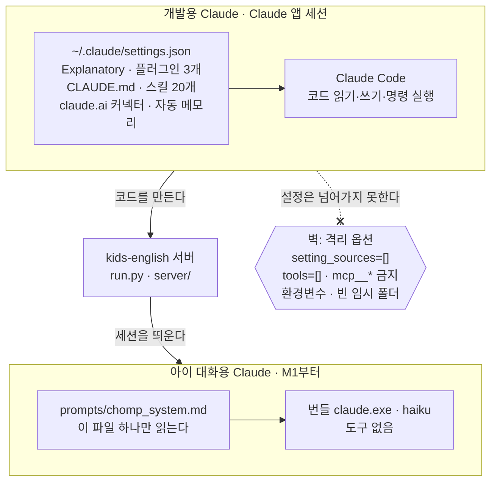
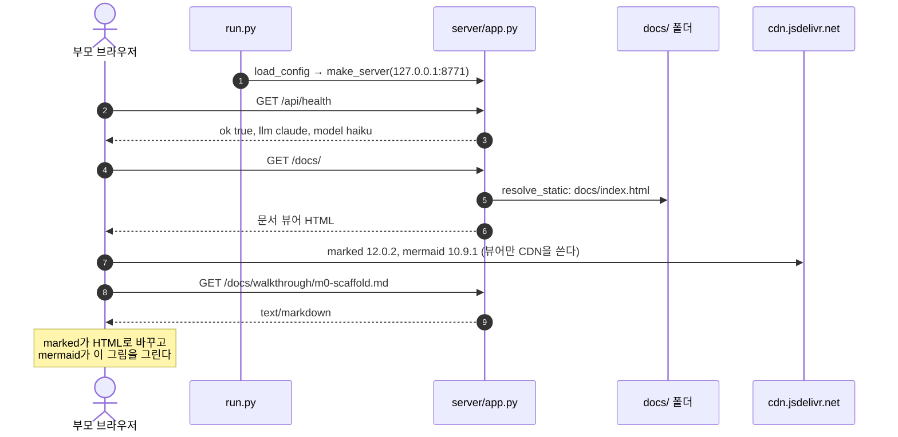

# M0 워크스루: 뼈대

- 작성: 2026-10-22. 코드 지도의 줄 번호만 2026-10-25에 M1 끝(M1 문서 커밋)에 맞춰 한 번, M2 끝(커밋 `37952d8`)에 맞춰 다시 고쳤다.
- 범위: Task 1(프로젝트 골격, 설정, health 서버) + Task 2(미리보기 설정, 문서 뷰어, 이 문서)
- 함께 볼 문서: [설계 spec](../superpowers/specs/2026-10-22-kids-english-design.md) · [C4 Context](../architecture/c4-context.md) · [ADR 템플릿](../adr/0000-template.md)

---

## 1. 1분 요약

- **지금 있는 것:** `run.py`를 켜면 `127.0.0.1:8771`에 작은 서버가 뜬다. 아이 화면 자리(`/`, 아직 "Hello, Chomp!" 한 줄), 상태 확인(`/api/health`), 이 문서 뷰어(`/docs/`)를 내준다.
- **안전장치부터 깔았다:** 서버는 이 PC 안에서만 열리고, `ANTHROPIC_API_KEY`가 환경에 있으면 지운다. `.env`와 `data/`는 git에 올라가지 않고, URL로 폴더 밖 파일(`.env` 등)을 빼 가는 요청은 404다.
- **미리보기:** Claude 앱의 미리보기 서버 이름은 `kids-english`(포트 8771)다. `.claude/launch.json`에 있다.
- **아직 없는 것:** 마이크, 캐릭터, Claude 연결. Claude 연결은 M1에서 붙인다. 오늘의 개념은 그 연결을 붙이기 전에 꼭 알아야 할 것이다.

## 2. 오늘의 개념: 개발용 Claude와 아이 대화용 Claude는 다르다

### 2-1. 같은 프로그램, 다른 두 역할

이 프로젝트에는 Claude가 둘 나온다. 둘 다 Claude Code(`claude.exe`)지만 하는 일이 정반대다.

| | 개발용 Claude | 아이 대화용 Claude (M1부터) |
|---|---|---|
| 누가 부르나 | 부모가 Claude 앱에서 | 우리 서버(`server/llm/claude_agent.py`)가 |
| 하는 일 | 코드를 읽고 쓰고, 명령을 실행하고, 길게 설명한다 | 멍멍이와 아기 공룡의 목소리로 영어 한두 마디와 JSON 하나를 낸다 |
| 읽는 설정 | `~/.claude/settings.json`, `CLAUDE.md`, 스킬, 플러그인, 커넥터 전부 | `prompts/chomp_system.md` **하나만** |
| 도구 | 파일, 셸, 브라우저, 메일 같은 커넥터 | **없음** |
| 작업 폴더 | `kids-english/` | 비어 있는 임시 폴더 `%TEMP%\kids_english_llm` |
| 상대 | 개발자 어른 | 6~7세 아이 |

개발용 Claude에게 좋은 설정이 아이 대화용 Claude에게는 전부 **독**이다. 아래에서 이 PC의 실제 설정으로 하나씩 보자.

### 2-2. 이 PC의 개발용 설정에 실제로 들어 있는 것

`~/.claude/settings.json`(사용자 홈의 `.claude` 폴더)에서 아이 대화와 관계있는 키는 둘이다(값은 2026-10-22 기준).

```json
{
  "outputStyle": "Explanatory",
  "enabledPlugins": {
    "superpowers@claude-plugins-official": true,
    "mermaid-diagrams@agent-toolkit": true,
    "c4-architecture@agent-toolkit": true
  }
}
```

이것 말고도 사용자 범위에서 따라오는 것이 더 있다.
- `~/.claude/skills/`의 사용자 스킬 20개(영상 제작용 hyperframes 등)
- claude.ai 계정에 연결해 둔 커넥터(메일, 드라이브, 메신저 같은 것)
- 프로젝트 폴더의 `CLAUDE.md`(개발 규칙), 폴더별 자동 메모리

### 2-3. 섞이면 아이 화면에서 무슨 일이 생기나

아이가 "Big red egg!"라고 말한 턴을 예로 든다. 우리가 바라는 답은 spec 5.5의 JSON 하나다(아래는 대략의 모양이고, 정확한 형식은 M1·M2에서 정한다).

```json
{"say":"Wow! A big red egg!","ops":[{"op":"add","kind":"egg","size":"big","color":"red"}], "...": "..."}
```

**Explanatory 출력 스타일이 섞이면**
- 이 스타일은 Claude가 일하면서 "★ Insight" 같은 교육용 설명을 덧붙이게 만든다. 개발할 때 부모에게 필요한 바로 그 기능이다.
- 아이 대화에서는 답이 이런 모양이 될 수 있다.

```
★ Insight ─────────────────────────────
아이가 형용사 두 개(big, red)를 명사 앞에 순서대로 썼습니다...
─────────────────────────────────────────
{"say":"Wow! A big red egg!", ...}
```

- 그러면 서버가 JSON을 깔끔하게 읽지 못하거나, `say`에 한글 설명이 섞인다. 검증기(M1 Task 5)가 감싼 글을 벗기거나 준비된 대사로 바꿔 놀이는 이어지게 한다. 그래도 설명 글을 쓰느라 답이 느려지고, 준비된 대사로 자주 떨어지면 아이는 같은 말만 듣게 된다.

**superpowers 플러그인이 섞이면**
- 이 플러그인은 세션이 시작될 때 훅으로 "답하기 전에 맞는 스킬부터 꼭 불러라, 만드는 일이면 brainstorming부터"라는 규칙을 집어넣는다.
- "Big red egg!"는 Claude 눈에 "무언가를 만드는 일"이다. 그래서 알을 만드는 대신 "Using brainstorming to..."라고 말하거나, 아이에게 되묻는 질문부터 할 수 있다. 계획 세우기, 테스트 먼저 쓰기 같은 개발 습관이 아이와의 놀이에 끼어든다.

**mermaid-diagrams, c4-architecture, 사용자 스킬 20개가 섞이면**
- 스킬 설명이 매 턴 Claude의 머릿속(컨텍스트)에 실린다. 아이 대화와 상관없는 글자가 많아질수록 답이 느려지고 구독 쿼터도 더 쓴다.
- 우리 목표는 LLM 답 p50 2.5초다(spec G1). 쓸데없는 글자는 그대로 지연이 된다.

**claude.ai 커넥터가 섞이면 (가장 위험)**
- 메일 보내기, 파일 지우기 같은 **진짜 행동을 하는 도구**가 아이 대화 세션에 들어온다.
- 아이가 "Send it to mom!"이라고 말했을 때 Claude가 도구를 쓸 수 있는 상태라면, 놀이가 실제 메일이나 메시지로 이어질 수 있다. 아이 놀이 세션에는 어떤 도구도 있으면 안 된다.

**CLAUDE.md와 자동 메모리가 섞이면**
- `CLAUDE.md`는 "TDD로 개발하라", "자격증명을 쓰지 마라" 같은 개발자용 규칙이다. 아이 대화에는 쓸모가 없고, 오히려 개발 이야기를 꺼내게 만든다.
- 자동 메모리에 아이 대화가 쌓이면 다른 세션에서 읽힐 수 있다. 아이 말은 `data/`에만 텍스트로 남겨야 한다(spec 7절).

### 2-4. 우리 앱은 이렇게 막는다 (spec 5.2, M1 Task 4에서 코드가 된다)

막는 방법은 "무엇을 막나" 기준으로 하나씩 짝이 있다.

| 섞이면 안 되는 것 | 막는 설정 | 어떻게 막나 |
|---|---|---|
| Explanatory 출력 스타일, 플러그인, 스킬, 훅, `CLAUDE.md` | `setting_sources=[]` | 사용자·프로젝트·로컬 설정 파일을 **하나도 읽지 않게** 한다 |
| Claude Code 기본 시스템 프롬프트 | `system_prompt`에 `prompts/chomp_system.md` 지정 | 기본 프롬프트(코딩 도우미 역할)를 통째로 갈아 끼운다 |
| 파일·셸 같은 내장 도구 | `tools=[]` | 도구 목록을 비운다 |
| MCP 도구, claude.ai 커넥터 | `disallowed_tools=["mcp__*"]`, `strict_mcp_config`, `mcp_servers={}`, `ENABLE_CLAUDEAI_MCP_SERVERS=false` | MCP 서버를 하나도 안 붙이고, 혹시 붙어도 이름이 `mcp__`로 시작하는 도구는 모두 금지한다. 계정 커넥터는 환경변수로 끈다 |
| 자동 메모리, `CLAUDE.md` 자동 로딩 | `CLAUDE_CODE_DISABLE_AUTO_MEMORY=1`, `CLAUDE_CODE_DISABLE_CLAUDE_MDS=1` | 설정을 비운 것과 별개로 환경변수로 한 번 더 끈다 |
| 프로젝트 폴더의 파일들 | 작업 폴더를 빈 ASCII 임시 폴더로 | `kids-english/` 안에서 돌지 않으니 읽을 파일이 없다. ASCII인 이유는 경로의 한글·공백 문제를 피하려는 것 |
| 대화 기록이 남는 것 | `--no-session-persistence` | Claude Code가 세션 기록 파일을 쓰지 않는다 |
| 여러 턴을 혼자 이어 가는 것 | `max_turns=1`, `permission_mode="dontAsk"` | 한 번 답하고 끝낸다. 허락이 필요한 일은 묻지 않고 거절한다 |
| 실수로 API 요금 | 서버 시작 때 `ANTHROPIC_API_KEY` 지우기 | M0부터 있다. M1에서 `ANTHROPIC_*`/`CLAUDE*` 전체로 넓혔다: `run.py:64`, `server/config.py:62` |

추가로 사용자가 `claude setup-token`으로 받은 토큰을 `.env`의 `CLAUDE_CODE_OAUTH_TOKEN`에 넣으면, 그 토큰으로 로그인한다. 이 토큰에는 claude.ai 커넥터가 따라오지 않아서 한 겹 더 안전하다(선택, 사용자가 직접 넣는다).

### 2-5. 막았다고 믿지 말고, 확인한다

- 설정을 써 넣는 것과 실제로 막혔는지는 다른 문제다. 그래서 M1의 `scripts/bench_llm.py`가 Claude 세션의 **첫 메시지(`init`)를 직접 열어 본다.**
  - `tools`, `mcp_servers`, `plugins`가 모두 빈 목록인가
  - `model`이 haiku인가
  - 출력 스타일이 없거나 기본값인가
- 하나라도 어기면 종료 코드 2로 끝나고, **구현을 멈추고 사용자에게 보고한다.** spec이 정한 유일한 "멈추는 조건"이다(spec G1).

### 2-6. 반대 방향: 아이 규칙은 어디에 쓰나

- 벽은 양쪽에 있다. 개발 설정이 아이 쪽으로 넘어가면 안 되듯, 아이에게 할 말의 규칙을 `CLAUDE.md`에 써 봐야 아이 대화용 Claude는 읽지 못한다.
- 그래서 `CLAUDE.md:6-9`가 "이 파일은 개발 세션용"이라고 먼저 밝힌다. 아이 대화 규칙("Wrong" 금지, 15단어 이하, JSON만)은 `prompts/chomp_system.md`(M1)에 따로 쓴다.
- `CLAUDE.md`의 "아이 UX 규칙"은 아이에게 하는 말이 아니라, 화면·소리·내용을 **만드는 개발용 Claude**가 지킬 규칙이다.

> **한 줄로:** 개발용 Claude는 이 PC의 모든 설정을 다 가진 "우리 집 비서"이고, 아이 대화용 Claude는 대본 한 장만 들고 빈 방에 들어간 "인형극 배우"다. M1의 할 일은 그 방을 정말 비우고, 비었는지 눈으로 확인하는 것이다.

## 3. 다이어그램

### 3-1. 두 Claude 사이의 벽



### 3-2. M0에서 실제로 오가는 요청



## 4. 코드 지도

줄 번호는 M2 끝(커밋 `37952d8`) 기준이다. M1의 Task 4–6이 `run.py`, `server/config.py`, `server/app.py`를 늘렸고, M2의 Task 13이 `run.py`를 한 번 더 늘려서 M0 때의 줄에서 옮겨 갔다. `server/config.py`와 `server/app.py`는 M1 뒤로 바뀌지 않았다.

| 위치 | 무엇 |
|---|---|
| `run.py:64` | 시작할 때 환경변수를 정리한다. 구독 인증만 쓰기 위한 첫 안전장치. M0에서는 `ANTHROPIC_API_KEY` 하나만 지웠고, M1(Task 4)에서 `ANTHROPIC_*`/`CLAUDE*` 전체(남기는 셋 제외)로 넓혔다 |
| `run.py:68-72` | 설정 읽기 → (M1부터) 턴 처리기 만들기 → 서버 만들기 → 주소 한 줄 출력 |
| `server/config.py:23` | `Config`. 기본값 127.0.0.1, 8771, haiku, 8초 |
| `server/config.py:31` | 토큰 필드는 `repr=False`. 설정을 출력해도 토큰이 로그에 남지 않는다 |
| `server/config.py:104` | `load_config`. 우선순위: 명령줄 > 환경변수 > `.env` > 기본값 |
| `server/app.py:46` | `STATIC_DIRS`. URL 첫 마디(`js`, `css`, `shared`, `docs`)와 폴더를 짝짓는 표 |
| `server/app.py:68` | `resolve_static`. 퍼센트 인코딩을 한 번만 풀고, 결과가 그 폴더 안일 때만 파일을 내준다(경로 탈출 차단) |
| `server/app.py:101` | `/api/health`. `--fake-llm`이면 `"llm": "fake"`, 아니면 `"claude"` |
| `server/app.py:209` | `Cache-Control: no-store`. 고친 파일이 캐시 때문에 옛 모습으로 보이지 않게 |
| `server/app.py:223` | Windows에서 `SO_REUSEADDR`를 끈다. 같은 포트에 서버 두 개가 뜨지 않게 |
| `CLAUDE.md:6-9` | "이 파일을 읽는 Claude는 누구인가". 오늘의 개념이 규칙으로 적힌 곳 |
| `CLAUDE.md:59` | 외부로 나가는 데이터 세 가지 |
| `.gitignore:3-4` | `data/`, `.env`를 git에서 뺀다 |
| `.env.example:4` | `CLAUDE_CODE_OAUTH_TOKEN=` 빈칸. 값은 사용자가 직접 넣는다 |
| `pytest.ini:6` | `-m "not live"`. 실제 Claude를 부르는 테스트는 기본으로 건너뛴다 |
| `tests/py/test_app.py:18` | health 테스트 |
| `tests/py/test_app.py:40-59` | 경로 탈출 요청이 모두 404인지 보는 테스트(벡터 목록 40–55, 테스트 함수 56–59) |
| `web/js/ndjson.js:14` | `readNdjson`. M1의 `/api/turn` 두 줄 응답을 읽는 함수. M0에 미리 만들어 두었고, 브라우저에서 처음 쓰는 곳은 `web/js/api.js:57`(M1 Task 7)이다 |
| `.claude/launch.json` | 미리보기 서버 `kids-english`, 포트 8771. M2부터 `"url": "http://127.0.0.1:8771"`로 연다(`localhost`는 새 연결마다 약 0.3초가 더 든다, [ADR-0004](../adr/0004-fastpath.md)) |
| `docs/index.html:158` | 문서 뷰어의 `DOCS` 배열. 문서를 늘릴 때 여기에 한 줄 더한다 |

## 5. 직접 해보기

1. **서버를 켜고 health 보기**
   ```bash
   .venv/Scripts/python run.py --fake-llm
   ```
   브라우저에서 `http://127.0.0.1:8771/api/health`를 연다. `"llm": "fake"`가 보인다. 서버를 끄고 `--fake-llm` 없이 다시 켜면 `"claude"`로 바뀐다(M0에는 아직 실제 연결이 없고 이름만 바뀐다).
2. **경로 탈출이 막혔는지 보기** (서버를 켠 채 다른 터미널에서)
   ```bash
   curl -i --path-as-is http://127.0.0.1:8771/docs/../.env
   ```
   `404`가 나와야 한다. `--path-as-is`를 빼면 curl이 `..`를 먼저 정리해 버려서 시험이 되지 않는다.
3. **문서 뷰어에 문서 하나 더하기:** `docs/index.html:158`의 `DOCS` 배열에 `{ title: "README", path: "../README.md" }`를 넣어 보면 "열 수 없는 경로"가 뜬다. 뷰어는 `docs/` 안의 파일만 연다. 실험이 끝나면 지운다.
4. **오늘의 개념 확인:** `~/.claude/settings.json`을 열어 `outputStyle`과 `enabledPlugins`를 찾아본다. M1에서 `scripts/bench_llm.py`를 돌리면, 이 값들이 아이 대화용 Claude의 `init` 메시지에 **하나도 나오지 않는 것**을 표로 보게 된다.
5. **테스트 돌리기**
   ```bash
   .venv/Scripts/python -m pytest -q
   node --test tests/js/*.test.mjs
   ```

## 6. 관련 ADR

- M0에는 새 결정 기록이 없다. 형식은 [ADR-0000 템플릿](../adr/0000-template.md)에 있다.
- 오늘의 개념(격리 옵션 전체와 bench 결과)은 M1의 [ADR-0001: 로컬 Claude Code를 Agent SDK로 상주시켜 부른다](../adr/0001-local-claude-via-agent-sdk.md)에 기록했다.

## 7. 다음에 바뀔 것 (M1: 걷는 뼈대)

- `server/llm/`: LLM 어댑터 틀과 `FakeLLM`(Task 3), 격리된 `ClaudeAgentLLM`과 `build_options`, `ISOLATION_ENV`(Task 4). 위 2-4절의 표가 그대로 코드가 된다.
- `scripts/bench_llm.py`: 격리 점검표와 20턴 지연 p50/p95(Task 4).
- `/api/turn`: 두 줄짜리 NDJSON 응답(Task 6). 그 응답을 브라우저에서 읽는 `web/js/ndjson.js`를 처음 쓰는 곳은 `web/js/api.js`(Task 7)다.
- 화면: 마이크, TTS, 멍멍이, 부모용 `?debug=1`(Task 7).
- 문서: `c4-container.md`(상자 안 열기), 한 턴 시퀀스 다이어그램, ADR-0001/0002, `m1-walking-skeleton.md`(오늘의 개념: "상주 프로세스와 stream-json")(Task 8).
