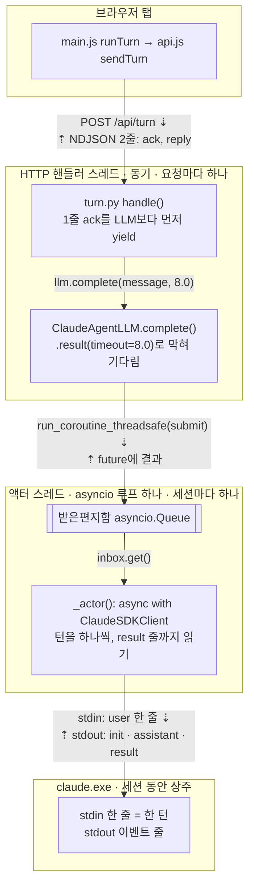

# M1 워크스루: 걷는 뼈대

- 작성: 2026-10-25 (M1 끝, 커밋 `259ea1b` 기준)
- 줄 번호: M2 끝(커밋 `37952d8`)의 실제 줄로 다시 맞췄다(Task 16). M2가 `server/turn.py`, `web/js/main.js` 같은 파일을 늘려서 M1 때의 줄에서 옮겨 갔기 때문이다. 설명은 M1 때의 동작이고, M2에서 달라진 곳은 그 자리에 "(M2)"로 적었다. 최종 리뷰 수정 뒤(커밋 `fea7dc3`) 바뀐 파일의 줄을 한 번 더 맞췄다.
- 범위:
  - Task 3: LLM 어댑터 틀, `FakeLLM`
  - Task 4: `ClaudeAgentLLM`, 격리, bench
  - Task 5: 답 파서와 검증기
  - Task 6: 턴 처리기와 `/api/turn`
  - Task 7: 화면
  - Task 8: 이 문서들
- 함께 볼 문서: [C4 Container](../architecture/c4-container.md) · [한 턴 시퀀스](../sequences/turn-m1.md) · [ADR-0001](../adr/0001-local-claude-via-agent-sdk.md) · [ADR-0002](../adr/0002-stdlib-server-and-llm-actor.md) · [M0 워크스루](m0-scaffold.md)

---

## 1. 1분 요약

- **지금 되는 것:**
  - 🎤를 누르고 영어로 말하면 서버가 이 PC의 진짜 Claude(haiku)에게 묻는다.
  - 멍멍이가 영어 자막과 목소리로 답한다. 생각하는 동안에는 통통 튀고, 말하는 동안에는 입을 여닫는다.
  - 부모는 `?debug=1`로 글자 턴을 넣고, 서버에서 온 줄과 걸린 시간(ms)을 본다.
- **빠르기:**
  - LLM 답은 p50 1.9초, p95 2.5초다(bench 20턴, 목표 2.5초/4초 안).
  - "생각 중" 신호(ack 줄)는 11–16 ms에 온다.
- **안전:**
  - 아이용 Claude는 개발용 설정을 하나도 보지 못한다. `init` 점검표가 모두 OK다.
  - API 키로 과금되는 길은 거부하고, 한 번 거부하면 서버가 꺼질 때까지 유지한다.
  - 부모 Claude Code 세션에서 물려받은 환경변수 약 30개를 시작할 때 지운다.
  - 구독 토큰은 사용자가 직접 넣은 `.env`에서 읽는다.
- **놀이는 멈추지 않는다:** 8초 시간 초과, 오류, 깨진 JSON, 아무 말도 안 들림, 서버 꺼짐. 어느 경우에도 준비된 대사가 나간다.
- **아직 없는 것:** 놀이판(아기 공룡, 공, 알), 단어장, fastpath. 모두 M2다. M1의 턴 요청에서 `scene`은 언제나 빈 목록이다. (M2에서 모두 생겼다: [M2 워크스루](m2-speak-to-build.md))

## 2. 오늘의 개념: 상주 프로세스와 stream-json

### 2-1. 비유: 배우를 무대에 세워 둔다

M0에서 아이 대화용 Claude를 "대본 한 장만 들고 빈 방에 들어간 인형극 배우"라고 했다. M1은 그 배우를 **어떻게 부르는가**의 문제다.

- **턴마다 부르기**(`claude -p`): 아이가 한마디 할 때마다 배우를 집에서 불러온다. 배우는 옷을 갈아입고 대본을 읽고(프로세스 시작 + 초기화), 대사 한 줄을 하고 집에 간다. 다음 한마디에 또 부른다.
- **상주시키기**(우리 앱): 아이가 화면을 열 때 배우를 한 번 무대에 세운다. 그다음은 쪽지(메시지 한 줄)만 건넨다. 배우는 무대에 선 채 앞에서 들은 말도 기억한다.

`claude.exe`가 그 배우이고, 쪽지를 건네는 통로가 **stream-json**이다.

### 2-2. 숫자로 보기: 왜 하나를 살려 두나

Task 4 bench(2026-10-24, 20턴)의 실제 숫자다.

| 구간 | 걸린 시간 | 언제 내나 |
|---|---|---|
| `claude.exe` 띄우기 + initialize | **1969 ms** (앞선 두 번은 735, 852 ms) | 상주: 세션을 열 때 한 번(아이가 말하기 전). 턴마다 부르기: **매 턴** |
| 한 턴(메시지 한 줄 → 답) | p50 **1890 ms**, p95 2543 ms | 매 턴 |
| 세션 첫 턴(콜드) | 3843 ms | 세션마다 한 번 |

- 상주시키면 아이가 기다리는 시간은 p50 약 1.9초다.
- 턴마다 부르면 연결 0.7~2.0초가 매번 더해져 약 2.6~3.9초가 된다(위 숫자로 계산). spec G1의 p50 목표 2.5초를 넘는다.
- 연결 비용을 "아이가 말할 때"에서 "화면을 열 때"로 옮기는 것이 핵심이다. 그래서 화면은 열리자마자 세션부터 연다(`web/js/main.js:68`). 서버는 `claude.exe`를 띄우기 **시작만** 하고 5 ms 만에 답한다(`server/llm/claude_agent.py:386`–`400`).
- 세션의 첫 턴이 느린 것(3.8초)은 아직 남아 있다. Task 7에서도 화면을 다시 연 지 4초 안에 말한 첫 턴이 3756 ms였고, 그다음 턴들은 1.5–2.0초였다.

### 2-3. stream-json: 줄 하나가 메시지 하나

`claude.exe`는 이렇게 뜬다(전체 명령줄은 [ADR-0001](../adr/0001-local-claude-via-agent-sdk.md#decision)).

```text
claude.exe --input-format stream-json --output-format stream-json --verbose ...
```

- **입력(stdin):** JSON 한 줄을 쓰면 그것이 사용자 메시지 하나다. 프로세스는 답을 낸 뒤 끝나지 않고 다음 줄을 기다린다. 이것이 "상주"를 가능하게 한다.
- **출력(stdout):** 답이 이벤트 단위로 한 줄씩 나온다.

우리 서버가 한 턴에 stdin으로 보내는 줄은 SDK의 `client.query()`가 만든다. 아래는 모양이다(`content` 안이 우리 턴 메시지, `server/prompt_builder.py:88`).

```json
{"type": "user", "message": {"role": "user", "content": "{\"heard\": [\"hello chomp\"], \"scene\": [], \"applied_ops\": [], \"hint_requested\": false}"}, "parent_tool_use_id": null, "session_id": "default"}
```

그러면 stdout으로 이런 줄들이 차례로 온다. 키를 줄여서 모양만 보였다.

```text
{"type": "system", "subtype": "init", "tools": [], "mcp_servers": [], "plugins": [], "model": "claude-haiku-5-5", "apiKeySource": "none", ...}
{"type": "assistant", "message": {"model": "...", "content": [{"type": "text", "text": "{\"say\": \"Hello! I am Chomp...\", ...}"}]}, ...}
{"type": "result", "subtype": "success", "is_error": false, "result": "...", ...}
```

- SDK가 이 줄들을 `SystemMessage`, `AssistantMessage`, `ResultMessage` 객체로 바꿔 준다. 우리 코드는 종류마다 할 일이 다르다(`server/llm/claude_agent.py:295`–`309`).

| 받은 줄 | 우리 코드가 하는 일 | 줄 |
|---|---|---|
| `system` / `init` | 세션의 첫 `init`을 격리 점검용으로 남기고, 턴마다 요금 판정(`apiKeySource`)을 한다 | `:297`–`303` |
| `assistant` | 글 조각(`TextBlock`)을 모으고 모델 이름을 기억한다 | `:304`–`307` |
| `result` | 이 턴의 **끝**. 오류 결과면 그 턴만 실패로 친다 | `:308`–`315` |

- **"끝"을 알리는 것은 `result` 줄 하나뿐이다.** 그래서 `receive_response()`를 `result`까지 끝까지 읽고 중간에 `break`하지 않는다(`:295`의 주석). 중간에 빠져나오면 남은 줄이 SDK의 수신 큐에 남아 있다가 **다음 턴의 답으로 읽힌다.** 아이가 "jump"라고 했는데 앞 턴의 "hello" 답이 나오는 식이다.
- 연결할 때의 initialize와 시간 초과 때의 interrupt도 같은 stdin에 JSON 한 줄(`control_request`)로 들어간다. 줄 하나가 메시지 하나라는 규칙은 같다.

### 2-4. 두 세계를 잇는 다리: 액터 스레드, 큐, `run_coroutine_threadsafe`

**문제.** 우리 서버에는 서로 말이 다른 두 세계가 있다.

| | 동기 세계 | 비동기 세계 |
|---|---|---|
| 누구 | HTTP 핸들러 스레드(요청마다 하나, `ThreadingHTTPServer`) | SDK의 `ClaudeSDKClient` |
| 말투 | 보통 함수 호출. 부르면 끝날 때까지 기다린다 | `async`/`await`. 이벤트 루프 위에서 돈다 |
| 규칙 | 아무 스레드에서나 돈다 | **연결한 그 async 컨텍스트 안에서만** 써야 한다(SDK 문서의 Caveat). 연결부터 종료까지 메시지를 읽는 task group 하나가 계속 살아 있기 때문이다 |

HTTP 스레드가 SDK를 직접 부를 수는 없다. 턴마다 `asyncio.run()`으로 루프를 새로 만들면 클라이언트가 그 루프와 함께 죽는다. 그러면 2-2의 상주가 깨진다.

**해결: 우체통.** 세션마다 이렇게 둔다. 아래 줄 번호는 따로 적지 않으면 모두 `server/llm/claude_agent.py`다.

1. **전용 스레드 하나, 이벤트 루프 하나**(`server/llm/claude_agent.py:216`, `:226`, `:229`–`232`). 이 스레드만 클라이언트를 만진다.
2. **액터 코루틴 하나**가 `async with ClaudeSDKClient(options)`를 세션 내내 쥔다(`:247`). `async with`가 끝나지 않으니 async 컨텍스트도 세션 내내 같다.
3. **받은편지함 `asyncio.Queue`**(`:217`). 액터는 여기서 턴을 하나씩 꺼내 처리한다(`:251`–`259`). 들어온 순서대로 하나씩 처리하는 것이 "액터"라는 이름의 뜻이다.
4. **우체통 투입구 `run_coroutine_threadsafe`.** HTTP 스레드의 `complete()`가 `submit(turn)` 코루틴을 **다른 스레드의 루프**에 맡긴다(`:420`, `:194`). `submit`은 루프 안에서 future를 만들어 큐에 넣고, 그 future가 채워지기를 기다린다(`:323`–`328`).
5. **스톱워치를 든 채 문 앞에서 기다리기.** `run_coroutine_threadsafe`는 HTTP 스레드 쪽에서 기다릴 수 있는 `concurrent.futures.Future`를 돌려준다. `complete()`는 `.result(timeout=8.0)`으로 막혀 기다린다(`:424`). 8초가 지나면 그만 기다리고 시간 초과를 낸다(아래 2-6).
6. 액터가 답을 future에 넣으면(`:273`) HTTP 스레드가 깨어나 `LLMResult`를 돌려준다(`:435`).

턴 처리기(`server/turn.py:311`)는 이 모든 것을 모른다. `self.llm.complete(message, self.timeout_s)`라는 보통 함수 하나만 부른다. `FakeLLM`도 같은 모양이라서, 테스트는 가짜를 꽂아 스레드와 asyncio 없이 턴 처리 전부를 시험한다.

**겹치지 않게 하는 세 겹:**
- 화면: 생각·말하는 중에는 리듀서가 🎤 탭을 무시한다(`web/js/ui_state.js:48`). 그사이 들어온 최종 인식 결과도 새 턴을 열지 않는다(`:58`).
- 서버: 턴 처리기의 잠금이 턴을 하나씩만 들인다(`server/turn.py:260`).
- 액터: 큐가 한 줄로 세운다.

### 2-5. 한 턴이 HTTP 선 위에서 보이는 모양: NDJSON 두 줄

서버와 `claude.exe` 사이가 stream-json이라면, 브라우저와 서버 사이는 **NDJSON**(줄마다 JSON 하나)이다. 같은 생각을 한 번 더 쓴 것이다. 아래는 `--fake-llm` 서버에 보낸 실제 응답이다(2026-10-25, M1 서버). (M2) 지금 서버에 같은 요청("hello chomp", 새 세션)을 보내면 1줄이 `ack`가 아니라 `fast`다. 자세한 것은 5절 1번.

```text
HTTP/1.0 200 OK
Content-Type: application/x-ndjson
Cache-Control: no-store

{"kind": "ack", "turn_id": 1}
{"kind": "reply", "turn_id": 1, "source": "llm", "say": "Good job! I'm Chomp. Let's play!", "recast": null, "choice": null, "korean_hint": "\uac19\uc774 \ub180\uc790! \u2192 Let's play!", "ops": [], "mood": null, "utterance": {"lang": "en", "words_used": [], "errors": []}, "latency": {"llm_ms": 0, "total_ms": 0}}
```

- **1줄 `ack`은 LLM을 부르기 전에 나간다.** 턴 처리기가 제너레이터라서 `yield` 한 번이면 된다(`server/turn.py:264`). (M2) 이 자리의 1줄은 fastpath가 맞으면 장면을 바꾸는 `fast` 줄이 된다. 핸들러가 그 줄을 바로 쓰고 `flush`한다(`server/app.py:177`, `:185`–`187`). 브라우저는 이 줄로 "서버가 받았다"를 안다. 실측 11–16 ms다.
- **2줄 `reply`는 답이 정해진 뒤에 나간다**(`server/turn.py:274`).
  - `source`는 `llm`(Claude의 답을 검증기가 통과시킴), `template`(들린 말이 없어 LLM을 안 부름), `fallback`(시간 초과·오류·JSON 아님) 중 하나다. (M2) 말이 단어장 표현과 exact로 맞은 턴도 LLM을 부르지 않고 `template`이다(`server/turn.py:305`–`307`).
  - `latency.llm_ms`는 서버가 잰 LLM 시간이다. `total_ms`는 요청을 받은 때부터다.
- **끝 신호:** HTTP/1.0이라 본문 길이를 미리 말하지 않는다. 서버가 연결을 닫으면 그것이 끝이다.
- **브라우저 쪽:**
  - `readNdjson`이 받은 바이트를 줄 단위로 끊어 하나씩 `JSON.parse`한다. 한글처럼 여러 바이트인 글자가 조각 경계에서 잘려도 이어 붙인다(`web/js/ndjson.js:14`, `:27`).
  - `sendTurn`이 줄마다 `onLine`을 부른다(`web/js/api.js:57`).
  - `main.js`가 줄 종류에 따라 리듀서에 이벤트를 보낸다(`web/js/main.js:216`–`231`). (M2) `fast` 줄의 ops는 연출기로, reply 줄은 장면 연출이 시작된 뒤 리듀서로 간다.
- 한글이 `\uac19`처럼 보이는 것은 줄을 ASCII로만 쓰기 때문이다(`server/app.py:35`–`37`). 짝 없는 서로게이트 같은 이상한 글자가 와도 쓰기가 실패하지 않는다.

### 2-6. 8초가 넘으면: 기다림만 버리고, 줄은 끝까지 읽는다

줄 번호는 따로 적지 않으면 `server/llm/claude_agent.py`다.

1. `complete()`의 `.result(timeout=8.0)`이 시간 초과를 낸다.
2. 기다림을 취소하고, 루프에 `abandon(turn)`을 맡긴다(`server/llm/claude_agent.py:425`–`428`).
3. `abandon`은 그 턴에 "포기함" 표시를 한다.
   - 아직 큐에 줄 서 있던 턴이면 액터가 보내지도 않고 건너뛴다(`:255`–`256`).
   - 이미 보내는 중이면 `client.interrupt()`로 Claude에게 그만하라고 한다(`:330`–`333`).
4. 액터는 그 턴의 `result` 줄까지 읽어 버린다. 그래서 다음 턴의 stream이 어긋나지 않는다. live 테스트가 진짜 CLI에서 이것을 확인했다(0.05초 시간 초과 → 다음 턴 정상 답).
5. 턴 처리기는 `LLMTimeout`을 받고 준비된 대사로 답한다(`server/turn.py:312`–`318`). 아이에게는 "Hmm! Let's try that again!" 같은 말이 나간다.

### 2-7. M1에서 실제로 부딪힌 것: "막았다고 믿지 말고 확인한다"

M0 워크스루 2-5절에서 "`init`을 직접 열어 본다"고 했다. 실제로 열어 보니 셋이 나왔다.

- **`plugins`가 비어 있지 않았다.** `claude.exe` 안에 들어 있는 기본 플러그인 3개(`agents-md`, `telemetry`, `plugin-authoring`)는 `setting_sources=[]`로 꺼지지 않았다. 그래서 `--settings`로 하나씩 껐다(`server/llm/claude_agent.py:61`–`64`).
- **부모 세션의 변수 30개.** 미리보기에서 켠 서버는 부모 Claude Code의 환경변수를 물려받았다. 그중 `CLAUDE_CODE_SIMPLE=1`은 구독 인증을 끄는 bare 모드다. 그래서 시작할 때 `ANTHROPIC_*`/`CLAUDE*`를 지운다(`server/config.py:57`–`70`, `run.py:64`).
- **저장된 로그인이 만료돼 있었다.** 그래서 사용자가 직접 `claude setup-token`으로 토큰을 받아 `.env`에 넣었다.

모두 [ADR-0001](../adr/0001-local-claude-via-agent-sdk.md)에 자세히 적었다.

> **한 줄로:** `claude.exe`는 세션 동안 무대에 서 있는 배우이고, stream-json은 그 배우에게 쪽지를 한 장씩 건네는 통로다. 동기 세계의 HTTP 스레드는 배우에게 직접 말을 걸 수 없어서, 액터 스레드의 우체통(큐)에 쪽지를 넣고 스톱워치를 든 채 8초까지 기다린다.

## 3. 다이어그램

### 3-1. 세 세계와 두 개의 다리



- 화살표는 요청이 가는 방향이다. 화살표 이름의 ⇣는 내려가는 것, ⇡는 같은 길로 돌아오는 답이다.
- 다리는 두 개다. 브라우저와 서버 사이는 NDJSON, 서버 안의 두 세계 사이는 `run_coroutine_threadsafe`와 큐다. 서버와 `claude.exe` 사이의 stream-json까지 치면 **줄 단위 JSON이 두 번** 나온다.

### 3-2. 전체 그림은 따로 있다

- 상자 구조(브라우저, Python 프로세스, 액터 스레드, `claude.exe`, `data/`): [C4 Container](../architecture/c4-container.md)
- 시간 순서와 구간마다 잰 지연: [한 턴 시퀀스(M1)](../sequences/turn-m1.md)

## 4. 코드 지도

### `server/llm/claude_agent.py` (상주 프로세스와 다리)

| 위치 | 무엇 |
|---|---|
| `server/llm/claude_agent.py:1-21` | 구조 설명: 세션마다 스레드 하나 + 루프 하나 + 클라이언트 하나, 끝까지 읽기, 요금 지킴이 |
| `server/llm/claude_agent.py:49-56` | `ISOLATION_ENV`: 아이용 `claude.exe`에만 주는 환경변수 6개 |
| `server/llm/claude_agent.py:61-64` | 기본 플러그인 3개를 끄는 `--settings` JSON |
| `server/llm/claude_agent.py:71` | `default_workdir`: 빈 ASCII 작업 폴더 |
| `server/llm/claude_agent.py:77-103` | `build_options`: 격리 옵션 전부. 토큰은 값이 있을 때만 자식 환경에 넣는다(`:82`–`83`) |
| `server/llm/claude_agent.py:127` | `check_isolation`: `init`으로 격리를 판정한다(bench가 쓴다) |
| `server/llm/claude_agent.py:152` | `billing_ok`: `apiKeySource == "none"`일 때만 통과 |
| `server/llm/claude_agent.py:168-171` | `_Turn`: 메시지, future, `abandoned` 표시 |
| `server/llm/claude_agent.py:208-226` | `_Session`: 루프(`:216`), 받은편지함 큐(`:217`), 데몬 스레드(`:226`) |
| `server/llm/claude_agent.py:229-242` | `_run`: 스레드 안에서 루프를 돌리고, 끝나면 남은 태스크와 루프를 정리 |
| `server/llm/claude_agent.py:244-286` | `_actor`: `async with ClaudeSDKClient`(`:247`) 안에서 큐의 턴을 하나씩. 포기한 턴은 건너뜀(`:255`–`256`). 끝날 때 줄 서 있던 턴을 실패로 알림(`:283`–`286`) |
| `server/llm/claude_agent.py:288-316` | `_run_turn`: `query`(`:289`) 한 번, `receive_response()`를 `result`까지(`:295`). 요금 판정(`:301`–`303`) |
| `server/llm/claude_agent.py:323-328` | `submit`: 루프 안에서 future를 만들어 큐에 넣고 기다린다 |
| `server/llm/claude_agent.py:330-333` | `abandon`: 포기 표시, 보내는 중이면 `interrupt()` |
| `server/llm/claude_agent.py:386-400` | `start_session`: 프롬프트 파일을 쓰고 스레드를 시작한 뒤 바로 돌아온다 |
| `server/llm/claude_agent.py:410-435` | `complete`: 다리. `run_coroutine_threadsafe`(`:420`) → `.result(timeout)`(`:424`) → 시간 초과면 `abandon`(`:425`–`428`) |
| `server/llm/claude_agent.py:437-444` | `end_session`: 종료 신호를 넣고 스레드를 최대 5초 기다린다 |

### `server/turn.py` (턴 하나를 두 줄로)

| 위치 | 무엇 |
|---|---|
| `server/turn.py:1-40` | 흐름 설명: 요청 검사 → 잠금 → 1줄(M1은 언제나 ack) → implicit start → 답 → reply. (M2) 1줄을 정하는 단계가 더해졌다 |
| `server/turn.py:68` | `redact`: 비밀 단어 가리기 자리(M3까지는 그대로 돌려준다) |
| `server/turn.py:137-160` | `parse_turn_request`: 후보 5개까지, 정리, 군소리("uh", "um") 빼기, 가리기. (M2) 한국어 판정을 가리기 전에(`:153`–`154`) |
| `server/turn.py:198` | 턴과 세션 시작·끝을 하나씩 들이는 잠금 |
| `server/turn.py:233-243` | `_start`: LLM 세션을 연다(연결은 기다리지 않음). 실패해도 놀이는 이어진다 |
| `server/turn.py:256-274` | `handle`: 1줄(`:264`) → 처음 보는 세션이면 연다(`:266`–`267`) → 답(`:270`) → 2줄 reply(`:274`) |
| `server/turn.py:302-328` | `_ask`: 들린 말이 없으면 template(`:303`–`304`), LLM 호출(`:311`), 실패면 fallback(`:312`–`318`), 파싱·검증(`:319`–`322`). (M2) fastpath exact면 LLM 없이 template(`:305`–`307`) |
| `server/turn.py:384-403` | `_log_turn`: 로그에는 가린 글자와 예외 **클래스 이름**만 쓴다 |

### `web/js/main.js` (화면 배선)

| 위치 | 무엇 |
|---|---|
| `web/js/main.js:1-9` | 한 턴의 흐름 설명 |
| `web/js/main.js:55-65` | TTS와 마이크 만들기. 최종 결과는 `MIC_RESULT`로(`:59`) |
| `web/js/main.js:68` | 화면을 열자마자 세션을 연다. 연결 비용을 첫 말 전에 낸다(2-2) |
| `web/js/main.js:70-79` | `?debug=1`일 때만 디버그 패널. 글자 턴의 엔진은 `debug-text` |
| `web/js/main.js:115-125` | `dispatch`: 리듀서 → 그리기 → 부수 효과 |
| `web/js/main.js:129-152` | `runEffects`: listening이 되면 마이크(`:130`–`138`, (M2) 12초 감시 포함), thinking이 되면 턴 보내기(`:140`–`143`), speaking이 되면 입 움직이며 말하기(`:144`–`150`) |
| `web/js/main.js:173-180` | `startMouth`: 200 ms마다 입 여닫기. 동작 줄이기 설정이면 움직이지 않는다 |
| `web/js/main.js:197-244` | `runTurn`: 요청 만들기(`:205`–`211`. M1은 `scene: []`, (M2) 지금은 `toWire(director.flush())`), 줄마다 처리(`:213`–`233`), reply가 없거나 답을 보이다 오류가 나면 화면이 대신 답한다(`:239`–`243`, `web/js/turn_end.js`) |
| `web/js/main.js:253-264` | `wake`: 첫 클릭에서 소리와 말하기를 깨운다 |
| `web/js/main.js:291-299` | 🎤 `pointerup` → `TAP_MIC`(`:299`). (M2) (?) 버튼도 같은 `onTap`을 쓴다 |

### 그 밖에 이번에 생긴 곳

| 위치 | 무엇 |
|---|---|
| `server/llm/__init__.py:42` | `LLM` 프로토콜: `start_session`, `complete`, `end_session` 셋. 진짜와 가짜가 같은 모양 |
| `server/app.py:35` | `ndjson_line`: ASCII 한 줄 |
| `server/app.py:161-183` | `/api/turn` 핸들러: 첫 줄 전에 요청 검사(400), 줄마다 write + flush, `finally`에서 `lines.close()` |
| `server/reply.py:72`, `:90` | `parse_reply_text`(설명문·코드펜스 속 JSON 찾기), `validate_reply`(어떤 입력이 와도 스키마를 만족하는 답) |
| `server/config.py:57-70` | `scrub_llm_env`: 부모 세션 변수 지우기 |
| `run.py:46-59` | `build_orchestrator`: `--fake-llm`이면 `FakeLLM`, 아니면 `ClaudeAgentLLM`. (M2) 카탈로그와 단어장도 읽는다 |
| `run.py:64` | 시작할 때 환경변수 정리(지운 이름만 출력) |
| `run.py:79` | 서버를 내릴 때 열린 세션을 끝내 `claude.exe`를 닫는다 |
| `web/js/ui_state.js:41` | `uiReducer`: idle → listening → thinking → speaking → idle. 잠금은 `:48`(탭), `:58`(최종 인식) |
| `web/js/api.js:47-61` | `sendTurn`: `fetch` + `readNdjson`, 15초 안전 시간 |
| `web/js/ndjson.js:14` | `readNdjson`: 줄 단위 읽기. 도중에 멈추면 스트림을 cancel |
| `web/js/tts.js:7` | `pickVoice`: en-US Online (Natural) Ana → 다른 Natural → en-US → en-*. 없으면 조용히 자막만 |
| `scripts/bench_llm.py:115` | bench 본체: 환경 정리, 옵션 출력, 턴별 지연, 격리 점검표, p50/p95 |
| `tests/py/test_claude_agent_options.py:33` | 격리 옵션 계약 테스트(쿼터 0) |
| `tests/py/test_api_turn.py:88` | ack가 LLM보다 먼저 도착하는지 보는 시간 테스트 |

## 5. 직접 해보기

1. **NDJSON 두 줄을 눈으로 보기** (쿼터 0)
   ```bash
   .venv/Scripts/python run.py --fake-llm --port 8773
   ```
   다른 터미널에서:
   ```bash
   curl -s -N -X POST http://127.0.0.1:8773/api/turn \
     -d '{"session_id":"try_m1","turn_id":1,"asr":{"alternatives":[{"t":"hello chomp"}]},"scene":[]}'
   ```
   - 두 줄이 나온다: `ack`, 그다음 `reply`.
   - (M2) 지금 서버에서는 1줄이 `{"kind": "fast", ..., "ops": [hatch, act chomp bark]}`다. "hello chomp"가 단어장 `hello`의 partial 표현이고(`content/words/level1_social.json:2`, `accept[2]`), 세션의 첫 영어 한마디라 알 부화도 함께 실리기 때문이다. 2줄은 여전히 `"source": "llm"`이다(partial은 LLM이 바른 문장을 다시 말해 준다). 같은 세션에서 다시 "hello chomp"를 보내면 1줄은 `fast [act chomp bark]`다. M1처럼 `ack`를 보려면 같은 세션의 다음 턴에 단어장에 없는 말(예: "what is your name", `turn_id` 2)을 보낸다. 2026-10-25 `--fake-llm` 서버로 넷 다 확인했다.
   - `alternatives`를 `[]`로 바꾸면 `"source": "template"`, `"llm_ms": null`이 된다. LLM을 부르지 않은 것이다. (M2에서도 같다: 1줄 `ack`, 2줄 `template`.)
   - 끝나면 서버를 끄고 `data/sessions/try_m1.jsonl`을 지운다(연습용 기록).
2. **ack가 먼저 오는 것을 시간으로 보기** (실제 Claude, 1턴)
   - 미리보기 `kids-english`를 켜고 `http://127.0.0.1:8771/?debug=1`을 연다.
   - "hello chomp"를 넣고 Enter를 누른다. 디버그 패널의 줄 목록에 `ack`이 10 ms대, `reply`가 1.5–4초대로 찍힌다.
   - (M2) 지금은 "hello chomp"의 1줄이 `ack` 대신 `fast`다(첫 턴이면 알 부화도 함께, 위 1번). 1줄이 LLM보다 먼저 온다는 점은 같다(Task 15 실측 fast 55–72 ms). `ack` 줄 자체를 보려면 알이 깨진 뒤에 단어장에 없는 말(예: "what is your name")을 넣는다. 그러면 실제 Claude를 2턴 쓴다.
   - 두 숫자의 차이가 곧 "Claude가 생각한 시간"이다.
3. **`claude.exe`가 상주하는지 보기**
   - 2번 화면을 연 채로 PowerShell에서 실행한다.
     ```powershell
     Get-Process claude | Select-Object Id, StartTime, Path
     ```
   - `Path`가 `...\.venv\Lib\site-packages\claude_agent_sdk\_bundled\claude.exe`인 줄이 우리 앱의 것이다. 그중 `StartTime`이 화면을 연 시각인 줄이 지금 세션이다.
   - 개발용 Claude 앱의 `claude.exe`나, 앞선 실험(bench, 테스트)에서 남은 것도 함께 보일 수 있다.
   - 턴을 몇 번 더 넣어도 그 `Id`와 `StartTime`은 그대로다.
   - 화면을 새로고침하면 새 세션이 열린다. 옛 프로세스가 닫히고 새 `Id`가 생긴다.
4. **시간 초과와 interrupt를 쿼터 없이 보기**
   ```bash
   .venv/Scripts/python -m pytest -q tests/py/test_claude_agent_options.py -k "timeout or abandoned or crash"
   ```
   가짜 `ClaudeSDKClient`로 "8초 넘음 → interrupt → 다음 턴은 정상", "줄 서 있다 포기한 턴은 보내지 않음"을 시험한다.
5. **잠금을 빼면 무엇이 깨지나** (생각 실험)
   - `server/turn.py:260`의 `with self._lock:`이 없다고 해 보자. 두 턴이 동시에 LLM을 부른다.
   - Task 6에서 실제로 잠금을 빼 보았더니 `test_turns_are_serialized`가 `assert 2 == 1`로 실패했다.
6. **격리 점검표 다시 보기** (실제 Claude, 쿼터 사용)
   ```bash
   .venv/Scripts/python scripts/bench_llm.py --turns 3
   ```
   - 3턴만 써도 점검표는 똑같이 나온다(p50/p95는 3개라 의미가 없다).
   - 20턴은 SDK를 올렸을 때만 돌린다. 사용자가 승인한 뒤에 돌린다.
7. **테스트 전체**
   ```bash
   .venv/Scripts/python -m pytest -q
   node --test tests/js/*.test.mjs
   ```

## 6. 관련 ADR

- [ADR-0001: 로컬 Claude Code를 Agent SDK로 상주시켜 부른다](../adr/0001-local-claude-via-agent-sdk.md)
  - 방식 비교(상주 SDK / 턴마다 `claude -p` / `--bare`)
  - 격리 옵션 전체, `--settings` 기본 플러그인 끄기, 환경변수 정리
  - `.env` 토큰, 요금 지킴이
  - bench 숫자, thinking 처리
- [ADR-0002: 표준 라이브러리 HTTP 서버와 asyncio LLM 액터 스레드](../adr/0002-stdlib-server-and-llm-actor.md)
  - SDK의 async 컨텍스트 제약
  - 2-4절의 다리
  - 직렬화 세 겹
- 다음: M2에서 [ADR-0003(턴 계약과 카탈로그)](../adr/0003-turn-contract-and-catalog.md), [ADR-0004(fastpath)](../adr/0004-fastpath.md)를 썼다. 형식은 [ADR-0000](../adr/0000-template.md).

## 7. 다음에 바뀔 것 (M2: 말로 짓기) — 모두 이루어졌다

M1을 끝낼 때 적은 계획이다. 결과는 [M2 워크스루](m2-speak-to-build.md)에 있고, 줄 번호는 지금(M2 끝) 줄이다.

- **카탈로그와 단어장**(Task 9, 10): `shared/catalog.json`, `content/words/*.json`.
  - 시스템 프롬프트의 `{VOCAB}`, `{CATALOG}`가 "(none yet)" 대신 실제 내용으로 채워진다(Task 13, `server/turn.py:207`–`210`).
- **fastpath**(Task 11, 13): 단어장 표현과 정확히 맞으면 LLM을 부르지 않는다.
  - 1줄이 `{"kind":"fast","ops":[...]}`가 되어 장면이 0.5초 안에 바뀐다(실측 55–72 ms).
  - 1줄을 계산하는 곳은 M1에서 ack를 내던 자리, 같은 잠금 안이다(`server/turn.py:263`–`264`).
- **검증기**(Task 12): M1은 LLM이 낸 `ops`를 모두 버렸다. 이제 카탈로그로 검사해서 맞는 것만 남긴다([ADR-0003](../adr/0003-turn-contract-and-catalog.md)).
- **화면**(Task 14, 15): 장면 모델·배치·그리기(`web/js/scene/model.js`, `layout.js`, `render.js`)가 생겼다.
  - `main.js`가 `fast` 줄의 `ops`를 장면에 바로 적용한다(M1 때는 리듀서에 알리기만 했다. 지금은 `web/js/main.js:218`–`221`).
  - 턴 요청의 `scene: []`가 실제 놀이판 상태가 됐다(`web/js/main.js:210`).
- **문서**(Task 16): [C4 Component](../architecture/c4-component-server.md), [fastpath 시퀀스](../sequences/turn-fastpath-m2.md), ADR-0003·0004, [M2 워크스루](m2-speak-to-build.md)(오늘의 개념: "결정적 렌더링").
