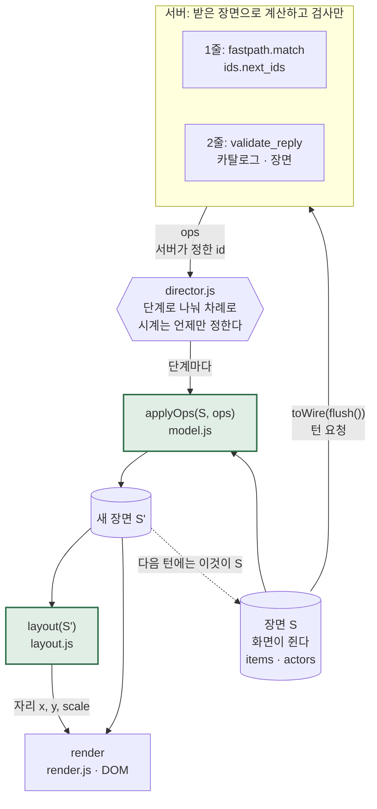

# M2 워크스루: 말로 짓기

- 작성: 2026-10-25 (M2 끝, 커밋 `37952d8`). 최종 리뷰 수정 뒤 다시 맞췄다: **아래 줄 번호는 모두 커밋 `fea7dc3`의 실제 줄이다.**
- 범위:
  - Task 9: 카탈로그 `shared/catalog.json`
  - Task 10: 단어장 45개와 로더
  - Task 11: fastpath
  - Task 12: 카탈로그로 ops 검증
  - Task 13: fastpath·부화·단어장 프롬프트를 턴에 연결
  - Task 14: 장면 모델, 배치, 공룡 포즈(순수 함수)
  - Task 15: 놀이판 그리기, 연출, (?) 힌트
  - Task 16: 이 문서들
  - 최종 리뷰 수정(2026-10-25): 서버를 다시 켜도 부화를 또 하지 않기(2-4절), 단어 한 줄을 더해도 테스트가 그대로 통과(5절 1번), 로그에 `hint_requested`, partial 턴의 못 쓸 `say`는 바른 문장으로, 턴이 "생각 중"에 갇히지 않기(`web/js/turn_end.js`), 메모장 BOM 단어장 읽기, 말 앞뒤의 "um"/"uh" 떼기, 끊긴 연결의 잠금 테스트
- 함께 볼 문서: [C4 Component(서버 안)](../architecture/c4-component-server.md) · [한 턴 시퀀스(M2)](../sequences/turn-fastpath-m2.md) · [ADR-0003 턴 계약과 카탈로그](../adr/0003-turn-contract-and-catalog.md) · [ADR-0004 fastpath](../adr/0004-fastpath.md) · [M1 워크스루](m1-walking-skeleton.md)

---

## 1. 1분 요약

- **지금 되는 것:**
  - 첫 화면은 둥지 속 알 하나다. 세션에서 처음 영어로 말하면 알이 흔들리고 금이 가고 깨지며 아기 공룡이 나온다.
  - "Kick the ball!"이라고 하면 공이 생기고 공룡이 찬다. "Big red egg!"면 큰 빨간 알이 생긴다. "Chomp the apple!"이면 사과가 생기고 멍멍이가 덥석 문다.
  - 단어는 45개다(레벨 1: 슈니비니 동작 16개와 멍멍이 명령·인사 11개, 레벨 2: 표정·색·크기·숫자·물건 18개).
  - 한국어로 말하면("빨간 알") 장면은 그대로이고, 멍멍이가 "Red egg? Say: red egg!"처럼 따라 할 영어를 준다.
  - (?)를 누르면 "공을 차 → Kick the ball!" 같은 한국어 힌트가 말풍선 **밖**에 보인다. 서버는 부르지 않는다.
- **빠르기:**
  - 단어장 문장과 맞으면 서버가 LLM 없이 장면을 바꾼다(fastpath). 브라우저 기준 55–72 ms.
  - Task 15 검증 턴 6개 중 5개는 LLM을 부르지 않았다(쿼터 0).
  - LLM 답은 p50 2.7초(n=5)로 **목표 2.5초를 넘었다.** M3에서 프롬프트부터 줄인다([ADR-0004](../adr/0004-fastpath.md)).
- **안전:**
  - LLM은 그림을 만들지 않는다. 카탈로그에 적힌 이름으로 된 짧은 조작(ops)만 낸다. 그림은 우리 SVG뿐이다.
  - 검증기가 카탈로그 밖의 것, 음식이 아닌 것 물기, 캐릭터 차기, "wrong"이 든 문장을 걸러 낸다. 한 턴 ops는 4개, 장면 물건은 20개까지다.
- **오늘의 개념:** 장면 모델과 배치는 **순수 함수**다. 같은 장면이면 언제 어디서 계산해도 같은 그림이다. 그래서 node에서 시험하고, 서버와 화면이 어긋나지 않는다.
- **테스트:** Python 1161개, JS 190개(M2 끝에는 1133개, 180개였고 최종 리뷰 수정이 더했다).
- **아직 없는 것(M3):** "Did you say X or Y?", 한국어 도움 버튼(ko-KR 인식), 따라 말하기 보상, 비밀 단어 가리기, quiz/dialogue 단어.

## 2. 오늘의 개념: 결정적 렌더링, "같은 상태면 같은 그림"

### 2-1. 비유: 바둑 기보

- 바둑 기보에는 돌을 놓은 **순서**만 적혀 있다. 판 그림은 없다.
- 그래도 누가 어디서 그 기보를 따라 놓든 **같은 판**이 나온다. 규칙(놓은 자리에 돌이 서고, 둘러싸인 돌은 들어낸다)이 정해져 있기 때문이다.
- 우리 앱도 그렇다.
  - **기보 = ops.** 서버가 보내는 것은 "공 하나를 놓아라(`add`), 공룡이 그것을 차라(`act`)" 같은 순서뿐이다. 그림은 보내지 않는다.
  - **규칙 = `applyOps`.** 지금 장면에 ops를 차례로 적용해 새 장면을 만든다.
  - **판을 그리는 법 = `layout`.** 장면만 보고 각 물건이 화면 어디에 서는지 정한다.
- 규칙과 그리는 법에 **시계, 난수, 화면 크기 같은 바깥 것이 끼지 않으면** "같은 장면 + 같은 ops → 같은 새 장면 → 같은 자리 → 같은 그림"이 언제나 성립한다. 이것이 **결정적(deterministic)** 이라는 뜻이다.

### 2-2. 순수 함수 셋 (우리 코드에서)

**순수 함수**는 (1) 입력만 보고 (2) 입력을 고치지 않고 (3) 바깥(화면, 시계, 파일)을 건드리지 않는 함수다. 같은 입력이면 언제나 같은 출력이다.

| 함수 | 하는 일 | 순수함을 지키는 곳 | 그것을 확인하는 테스트 |
|---|---|---|---|
| `applyOps(scene, ops, catalog)` | 장면에 ops를 적용한 **새** 장면 | 먼저 장면을 통째로 복사하고(`web/js/scene/model.js:43`, `:71`–`94`) 복사본만 고친다. ops의 자리 객체도 복사해 넣는다(`:117`) | `tests/js/model.test.mjs:40`(원래 장면 그대로), `:47`(얼린 장면과 얼린 ops를 넣어도 예외 없음) |
| `layout(scene, catalog, view)` | 각 물건과 캐릭터의 `{x, y, scale}` | 시계·난수가 없다. 순서는 장면 목록 순서로만 정하고(`web/js/scene/layout.js:115`), 자리는 소수 둘째 자리로 반올림한다(`:68`, `:178`–`179`) | `tests/js/layout.test.mjs:30`(두 번 계산해 같음), `:38`–`46`(복제한 장면도 같은 그림) |
| `drawOrder`, `diffScene`, `poseTransforms` | 그리는 순서, 앞 장면과의 차이, 공룡 부위 각도 | DOM을 쓰지 않는다(`web/js/scene/frame.js:1`). 포즈는 얼린 표에서 읽기만 한다(`web/js/scene/poses.js:29`, `:76`–`78`) | `tests/js/frame.test.mjs`, `tests/js/poses.test.mjs` |

- 네 파일(`model.js`, `layout.js`, `frame.js`, `poses.js`)에는 `Math.random`, `Date`, `document`, `setTimeout`이 한 번도 나오지 않는다(2026-10-25 grep으로 확인).
- **순수하지 않은 곳은 일부러 한쪽에 모았다.**
  - `web/js/scene/render.js`: 진짜 SVG를 고친다(DOM). 장면과 자리를 받아 "그 모습이 되게" 맞출 뿐 장면을 바꾸지 않는다(`:164`–`229`).
  - `web/js/scene/director.js`: 시간을 다룬다. 시계는 밖에서 받는다(`:49`의 `timers`). 그래서 테스트에서는 가짜 시계로 돌린다.
  - `web/js/main.js`: 위를 잇는다.

### 2-3. 우리 앱에 대입: 첫 턴 "kick the ball"

1. **처음 장면**(`web/js/scene/model.js:27`–`39`): 둥지 `nest1`(왼쪽), 그 안에 알 `egg1`, 공룡은 아직 안 깨어남.
2. **서버가 보낸 1줄**(2026-10-25 `--fake-llm` 서버의 실제 줄):

   ```json
   {"kind": "fast", "turn_id": 1, "ops": [{"op": "act", "actor": "dino", "action": "hatch"}, {"op": "add", "kind": "ball", "id": "ball1", "count": 1}, {"op": "act", "actor": "dino", "action": "kick", "target": "ball1"}], "sfx": "pop"}
   ```

3. **`applyOps`가 차례로 적용한다:**
   - `hatch`: 공룡을 깨우고(`hatched: true`) `egg1`을 없앤다(`web/js/scene/model.js:164`–`170`).
   - `add`: 서버가 준 id `ball1` 그대로 공을 넣는다(`:124`–`136`).
   - `act kick`: 공룡의 상태를 `kick`으로(`:172`).
4. **`layout`이 자리를 정한다**(1200×600 기준, node로 계산한 실제 값):
   - 공룡 `{x: 504, y: 273}`: 고정 자리 0.42 × 1200 = 504, 무대 바닥 0.58 × 600 = 348에서 키의 절반(75)을 뺀 273(`web/js/scene/layout.js:84`–`86`).
   - 공 `{x: 250, y: 496}`: 앞마당 맨 앞줄(바닥 0.88 × 600 = 528)에서 공 높이의 절반(32)을 뺀 496. 가로는 12칸(칸마다 100)인데 0–1칸은 둥지가 먼저 차지해서 셋째 칸의 가운데 250(`:111`–`147`).
5. **`render`가 그 모습이 되게 맞춘다.** 공룡이 알 자리에서 튀어나오고, 공이 퐁 생기고, 공룡이 찬다.

같은 처음 장면에 같은 세 ops를 몇 번 적용하든 공룡은 (504, 273), 공은 (250, 496)이다. 5절 3번에서 직접 해 본다.

### 2-4. 서버와 화면이 어긋나지 않는 까닭

**장면은 한 곳(화면)에만 있다.** 서버는 받은 장면으로 계산하고 검사만 한다.

| 누가 | 무엇을 기억하나 | 어디서 |
|---|---|---|
| 화면 | 장면 전체(물건, 캐릭터 상태, 표정, 입은 것) | 연출기의 `current`(`web/js/scene/director.js:51`) |
| 서버 | 세션 id, 턴 수, "알이 깨졌나" 하나(화면이 `hatched: true`라고 하면 그 말이 앞선다) | `server/turn.py:199`–`201` |

한 턴은 이렇게 돈다.

1. 화면이 지금 장면을 요청에 싣는다. `scene: toWire(director.flush())`(`web/js/main.js:210`). `flush()`는 아직 연출 중인 단계와 쉬는 자세까지 지금 다 적용한 **최종** 장면을 돌려준다(`web/js/scene/director.js:117`–`133`). 공룡 줄에는 깨어났는지(`hatched`)도 실린다(`web/js/scene/model.js:56`).
2. 서버는 그 장면으로 fastpath를 돌린다. "kick the ball"의 대상은 **그 장면에서** 가장 최근의 공이다(`server/fastpath.py:348`–`353`). 공이 없으면 **그 장면의** 가장 큰 번호 + 1로 새 id를 정한다(`server/ids.py:23`–`37`).
3. LLM의 ops도 **같은 장면**으로 검사한다(`server/turn.py:320`–`322`). 장면에 없는 대상을 가리키는 op는 버려진다.
4. 화면은 서버가 정한 id를 **그대로** 쓴다(`web/js/scene/model.js:124`–`136`). 서버가 "ball1을 차라"고 검사한 그 `ball1`이 화면의 그 공이다.

그리고 같은 규칙을 **양쪽이 따로 한 번씩** 지킨다. 서버가 놓친 것이 있어도 화면 모델이 한 번 더 걸러서, 화면이 깨지지 않는다.

| 규칙 | 서버 검증기 `server/reply.py` | 화면 모델 `web/js/scene/model.js` |
|---|---|---|
| 카탈로그에 없는 물건은 안 생긴다 | `:383`–`386` | `:109`–`112`, `:223`–`225` |
| 색·크기는 카탈로그 값이고, 그 물건이 가질 수 있을 때만 | `:325`–`338` | `:231`–`237` |
| 자리는 zone이거나 장면의 물건 옆, 고리 금지 | `:340`–`362` | `:239`–`260` |
| 멍멍이는 음식만 문다(화면은 문 음식만 없앤다) | `:418`–`419` | `:174`, `:177`–`181` |
| `put_on`은 입을 수 있는 것만 | `:420`–`421` | `:183`–`189` |
| 장면 물건은 20개까지 | `:257`–`258`(적기만 함) | `:273`–`287`(오래된 것부터 치움) |

**서버가 기억하는 유일한 것, 부화**도 화면의 말을 따른다. 이것은 최종 리뷰에서 고친 곳이라, 무엇이 틀렸었는지가 이 절의 개념을 잘 보여 준다.

- **전에는:** 서버는 자기 기억("이 세션에서 알이 깨졌나")만으로 부화를 정했다. 단어장을 고치고 서버를 다시 켜면(README가 시키는 일) 기억이 비어서, 열린 화면의 다음 영어 턴에 `hatch`를 또 보냈다. 화면의 `hatch`는 이미 깨어 있으면 아무것도 하지 않으니(`web/js/scene/model.js:164`–`166`, `tests/js/model.test.mjs:177`) **화면은** 괜찮았다.
- **그런데 서버의 계산이 어긋났다.** 서버는 부화 턴마다 `egg1`(둥지 알)을 지운 장면으로 fastpath와 검증기를 돌린다. 부화 뒤에 아이가 만든 첫 알도 `egg1`이다(그 장면의 가장 큰 번호 + 1, `server/ids.py:7`–`14`). 그래서 빨간 `egg1`이 있는 화면에서 "kick the egg"는 `[hatch, add egg2, kick egg2]`가 됐고(새 알을 하나 더 만들어 찼다), "throw out the egg"는 아무것도 치우지 않았다. 화면과 서버가 **같은 장면을 보지 않은** 것이다.
- **지금은:** 장면의 공룡 줄이 `"hatched": true`면 서버는 부화하지 않고, 이 세션을 부화한 것으로 기억한다(`server/turn.py:159`, `:263`, `:268`–`269`). 서버를 다시 켜도 `egg1`은 아이의 알 그대로 fastpath와 검증기의 대상이 된다(`tests/py/test_turn_m2.py:264`–`308`).
- **배울 점:** "장면은 화면 한 곳에만 있다"는 원칙을 서버의 작은 기억 하나가 깨고 있었다. 화면이 이미 아는 것(공룡이 깨어났다)은 서버가 따로 기억하지 말고 화면에게서 받는다. 서버의 기억은 화면이 말해 주지 않을 때(예: `hatched` 없이 보내는 테스트)의 대비일 뿐이다.

### 2-5. 연출(director)은 결정성을 깨지 않는다

화면은 1줄의 ops를 한꺼번에 그리지 않는다. "알이 깨지고 → 공이 생기고 → 공룡이 찬다"를 차례로 보여 준다. 시간이 끼어드는데 어떻게 "같은 상태면 같은 그림"이 지켜질까?

- **`stageOps`는 순서를 바꾸지 않고 자르기만 한다**(`web/js/scene/director.js:33`–`43`). `hatch`는 혼자, 이어진 `add`들은 한 단계, 이어진 나머지(`act`, `set`, `move`, `remove`)도 한 단계다. 단계 사이 기다림은 부화 1100 ms, 물건 450 ms, 동작 800 ms다(`:15`–`17`).
- **단계마다 똑같이 `applyOps`를 부른다**(`web/js/scene/director.js:63`–`71`). 그래서 단계로 나눠 적용한 끝 장면은 한꺼번에 적용한 장면과 같다. 2026-10-25에 세 가지 줄(부화+공+차기 / 사과+덥석+알 둘+지우기 / 양말+신기+표정+옮기기)로 node에서 확인했다: 둘이 `deepEqual`이다.
- **"쉬는 자세로 돌아가기"도 op다.** 동작이 끝나면 연출기가 `{op:"act", actor, action:"idle"}`을 `applyOps`로 적용한다(`:73`–`80`, 기다림은 동작마다 `:20`–`21`). 시간이 하는 일은 **언제** 적용하느냐뿐이고, **무엇을** 적용하느냐는 op에 다 적혀 있다.
- **다음 턴 요청 전에 `flush()`** 로 남은 단계를 다 적용한다(`web/js/main.js:210`). 그래서 서버는 연출이 어디까지 왔는지와 관계없이 언제나 "다 끝난 장면"을 받는다.
- **한 번만 하는 움직임은 장면 상태가 아니다.** 퐁 생기기, 흔들기, 덥석 달려들기는 `render.js`가 `.fx` 그룹에 거는 애니메이션이다(`web/js/scene/render.js:6`–`7`). 자리와 크기를 정하는 transform과는 다른 그룹이라 서로 덮어쓰지 않는다. 동작 줄이기 설정이면 이 움직임을 건너뛰지만(`:35`, `:167`) 끝 그림은 같다.

### 2-6. 그래서 무엇을 얻었나

- **브라우저 없이 시험한다.** 장면 모델, 배치, 연출, 그리기 계산의 테스트가 `node --test`로 1초 안에 돈다(JS 180개).
- **다시 그릴 수 있다.** 세션 기록에는 턴마다 1줄 ops(`fast_ops`)와 2줄 ops(`ops`)가 남는다(`server/turn.py:391`, `:395`–`396`). 처음 장면에서 그 ops를 차례로 적용하면 그 세션의 장면을 그대로 다시 만들 수 있다. 디버그 패널도 실제로 적용된 ops를 어느 줄에서 왔는지(`fast`, `reply`, `local`)와 함께 보여 준다(`web/js/debug.js:1`–`5`).
- **버그가 어디 있는지 좁혀진다.** 그림이 이상하면 (1) ops가 이상한가(서버), (2) 장면이 이상한가(`applyOps`), (3) 자리가 이상한가(`layout`), (4) 그리기가 이상한가(`render`) 중 하나다. 앞의 셋은 node에서 바로 재현된다.

> **한 줄로:** 서버는 기보(ops)만 보내고, 화면은 판(장면)을 쥐고 규칙(`applyOps`)대로 돌을 놓고, 판을 보고 자리(`layout`)를 정한다. 규칙과 자리 정하기에 시계도 난수도 없으니, 같은 판에 같은 수를 두면 누가 언제 두어도 같은 그림이다. 시간은 "언제 보여 줄까"만 정한다.

## 3. 다이어그램

### 3-1. 장면이 도는 길



- 오른쪽 아래의 장면 `S`에서 시작해 실선을 따라가면 한 턴이다. 요청으로 올라가 서버를 거친 ops가 다시 내려와 새 장면 `S'`과 그림이 된다. 점선은 "새 장면이 다음 턴의 장면이 된다"는 뜻이다.
- 서버 상자 안에는 장면을 담아 두는 칸이 없다. 받은 장면으로 계산하고 검사한 뒤 ops만 돌려준다.
- 초록 상자 둘(`applyOps`, `layout`)이 순수 함수다. 그림을 실제로 바꾸는 것은 맨 끝 `render` 하나다.

### 3-2. 전체 그림은 따로 있다

- 서버 안 부품(턴 처리기, fastpath, 검증기, 카탈로그, 단어장): [C4 Component](../architecture/c4-component-server.md)
- 시간 순서와 exact / partial / 맞지 않음 / 한국어 갈래: [한 턴 시퀀스(M2)](../sequences/turn-fastpath-m2.md)
- 상자 구조(브라우저, Python 프로세스, `claude.exe`, 파일): [C4 Container](../architecture/c4-container.md)

## 4. 코드 지도

### 서버: 1줄과 2줄 (`server/turn.py`)

| 위치 | 무엇 |
|---|---|
| `server/turn.py:1`–`40` | 흐름 설명: 요청 검사 → 잠금 → 1줄(부화, fastpath) → 2줄(템플릿 또는 LLM) |
| `server/turn.py:64`–`65` | `HATCH_OP`, `HATCH_EGG = "egg1"` |
| `server/turn.py:106`–`109` | 1줄: ops가 있으면 `fast`, 없으면 `ack` |
| `server/turn.py:111`–`119` | 검증기에 줄 "이미 적용한 ops". 부화가 `egg1`을 지운다는 것을 적어 넣는다 |
| `server/turn.py:153`–`154` | 한국어 판정은 가리기(`redact`) 전에 |
| `server/turn.py:159` | 화면이 보낸 공룡 줄의 `"hatched": true` 읽기 |
| `server/turn.py:256`–`274` | `handle`: 잠금 → 부화했나(화면의 말 또는 서버 기억, `:263`) → 1줄 yield(`:264`) → 세션 열기 → 부화 표시(`:268`–`269`) → 2줄(`:274`) |
| `server/turn.py:276`–`284` | `_plan`: 부화 + fastpath, 4개 한도 |
| `server/turn.py:302`–`328` | `_ask`: exact면 템플릿(`:305`–`307`), 아니면 LLM과 검증. partial인데 `say`를 통째로 못 쓰면 fastpath의 바른 문장(`:325`–`326`) |
| `server/turn.py:330`–`339` | 2줄 ops: LLM의 `hatch` 빼기, 1줄과 합쳐 4개 |
| `server/turn.py:350`–`374` | 템플릿 답과 `korean_hint`("공을 차 → Kick the ball!") |
| `server/turn.py:384`–`403` | 로그의 turn 줄. (?)를 누르고 온 턴이면 `hint_requested: true`(`:393`) |

### 서버: fastpath, id, 검증기, 프롬프트

| 위치 | 무엇 |
|---|---|
| `server/fastpath.py:1`–`23` | 문법 두 개와 판정 규칙 설명 |
| `server/fastpath.py:97`–`118` | `match`: n-best를 앞에서부터, 처음 맞는 후보. 통째로 안 맞으면 앞뒤 군소리를 떼고 한 번 더(`:112`–`114`, `_without_fillers` `:131`) |
| `server/fastpath.py:141`–`174` | `_Grammar`: 레벨 이하 단어로 문장·틀·물건·꾸밈말 표 만들기 |
| `server/fastpath.py:266`–`285` | 단어 문장: exact는 `accept[0]`(`:272`) 또는 관사 틀 + 바른 순서(`:283`) |
| `server/fastpath.py:288`–`330` | `_present`: 동작과 물건 잇기, 음식만 물기(`:309`–`310`), 단수면 하나만 치우기(`:327`–`328`) |
| `server/ids.py:23`–`37` | `next_ids`: 종류 + 가장 큰 번호 + 1 |
| `server/reply.py:165`–`177` | ops를 통째로 버리는 경우: 한글 입력, `lang:"ko"`, `say` 교체, 카탈로그 없음 |
| `server/reply.py:199`–`455` | `_OpsChecker`: op 하나씩 카탈로그·장면·안전 규칙으로 검사하고 새 dict로 다시 만들기 |
| `server/reply.py:63`–`67` | "wrong"/"incorrect" 걸러내기, 캐릭터를 차거나 내던지지 않기 |
| `server/prompt_builder.py:38`–`50` | `word_sentence`: "Throw out the {object}" → "Throw out" |
| `server/prompt_builder.py:63`–`85` | `vocab_lines`(`English \| 한국어 \| id`), `catalog_summary` |
| `server/catalog.py:39`, `:83` | `Catalog`(읽기 전용), `load_catalog`(틀리면 서버가 안 뜬다) |
| `server/words.py:54`, `:67`, `:103` | `Word`, `WordBank`, `load_words`(파일·단어·키를 담은 오류). 메모장의 BOM도 읽는다(`:132`) |
| `server/text.py:31`–`43` | `normalize`: "Let's dance!" → "lets dance", `{object}`는 남긴다 |
| `run.py:56`–`57` | 서버를 켤 때 카탈로그와 단어장을 읽는다 |

### 데이터

| 위치 | 무엇 |
|---|---|
| `shared/catalog.json:3`–`16` | 캐릭터 둘의 동작과 표정. `hatch`는 서버만 보낸다 |
| `shared/catalog.json:17`–`31` | 물건 13종. SVG 7종(모두 색을 바꿀 수 있고, 양말·모자 말고는 크기도), 이모지 6종(그중 음식 3종) |
| `shared/catalog.json:32`–`38` | 색 8, 크기 2, 개수 5, 자리, 한도(ops 4, 물건 20) |
| `content/words/level1_actions.json` | 레벨 1 동작 21개(슈니비니 16 + 멍멍이 명령 5) |
| `content/words/level1_social.json` | 레벨 1 인사 6개 |
| `content/words/level2_starter.json` | 레벨 2 표정·색·크기·숫자·물건 18개 |
| `prompts/chomp_system.md:6` | 부화는 게임이 한다, LLM은 `hatch`를 보내지 않는다 |
| `prompts/chomp_system.md:31`–`37` | `{VOCAB}`, `{CATALOG}` 자리 |
| `prompts/chomp_system.md:39`–`49` | LLM이 쓸 수 있는 op 모양과 id 규칙 |
| `prompts/chomp_system.md:52` | "No code fences, no explanations, no HTML, no SVG." |
| `prompts/chomp_system.md:64`–`75` | 예시 셋(partial 리캐스트, 한국어, LLM이 ops를 내는 경우). 테스트가 셋 다 검증기를 통과하는지 본다(`tests/py/test_turn_m2.py:541`) |

### 화면: 장면 (`web/js/scene/`)

| 위치 | 무엇 |
|---|---|
| `web/js/scene/model.js:27`–`39` | `initialScene`: 둥지 속 알 |
| `web/js/scene/model.js:42`–`49` | `applyOps`: 복사하고 하나씩 적용 |
| `web/js/scene/model.js:52`–`67` | `toWire`: 요청에 실을 장면 |
| `web/js/scene/model.js:124`–`136` | 서버 id 그대로 쓰기 |
| `web/js/scene/model.js:157`–`181` | `act`: 멱등 `hatch`(`:164`–`170`), 입기, 음식 먹기 |
| `web/js/scene/model.js:273`–`287` | 20개 한도: 오래된 것부터, 입은 것은 남기고, 나무·둥지는 맨 나중 |
| `web/js/scene/layout.js:1`–`24` | 놀이판의 모양(하늘, 무대, 앞마당 3줄, 12칸)과 자리 정하는 법 |
| `web/js/scene/layout.js:70`–`181` | `layout`: 캐릭터(`:84`–`86`) → 입은 것 → 격자(`:111`–`147`) → 옆·위·아래·안(`:149`–`176`) |
| `web/js/scene/poses.js:29`–`73` | 공룡 동작 포즈 표. 동작 하나 = 한 줄 |
| `web/js/scene/frame.js:24`–`75` | `drawOrder`: 둥지 속 알은 둥지 다음, 그 위에 둥지 앞 테두리 |
| `web/js/scene/frame.js:84`–`117` | `diffScene`: 새로 생긴 것, 사라진 것(부화/먹힘/치움), 동작 |
| `web/js/scene/director.js:33`–`43` | `stageOps`: 순서는 그대로, 단계로 자르기 |
| `web/js/scene/director.js:49`–`153` | `createDirector`: `play`(`:108`), `flush`(`:117`), `whenIdle`(`:135`) |
| `web/js/scene/render.js:164`–`229` | `render`: 그룹 다시 쓰기 → 사라지는 것 → 자리와 순서 → 캐릭터 모습 → 한 번만 하는 움직임 |
| `web/js/scene/sprites.js:122`, `:236`, `:321` | 팔레트 8색, `dinoSvg`(부위 그룹), `objectSvg`(이모지 물건은 카탈로그의 글자) |

### 화면: 배선 (`web/js/main.js`)

| 위치 | 무엇 |
|---|---|
| `web/js/main.js:85`–`103` | 연출기 만들기, 카탈로그 받기(`:91`–`98`), 그리기(`:101`–`103`) |
| `web/js/main.js:197`–`244` | `runTurn`: 요청(`:205`–`211`), fast 줄(`:218`–`221`), reply 줄(`:222`–`231`), 대체 대사(`:239`–`243`, `web/js/turn_end.js`) |
| `web/js/turn_end.js:13`–`18`, `:24`–`39` | `startShowing`, `endTurn`: 답을 보이다 무엇이 throw 해도 턴은 답이나 대체 대사로 끝난다(DOM 없음, `tests/js/turn_end.test.mjs`) |
| `web/js/main.js:115`–`125` | `dispatch`: 그리기가 throw 해도 전이에 딸린 일(말하기 → `TTS_END`)은 한다 |
| `web/js/main.js:106`–`110` | reply의 `mood`를 장면의 `set` op로(표정도 장면에 있어야 다음 턴에 서버가 안다) |
| `web/js/main.js:300` | (?) 버튼 → `TAP_HINT`(서버를 부르지 않는다) |
| `web/js/ui_state.js:65`–`68` | `TAP_HINT`: 힌트를 보이고, 다음 턴 요청에 `hint_requested: true`(`:61`) |

## 5. 직접 해보기

### 1. 단어 하나 더하기: JSON 한 줄

카탈로그에는 쿠키(🍪, 음식)가 이미 있는데 단어장에는 아직 없다. 한 줄로 더해 보자.

1. `content/words/level2_starter.json`을 연다. **마지막 줄(`apple`) 바로 앞**에 이 줄을 넣는다. 마지막 단어 뒤에 붙이면 앞 줄 끝에 쉼표를 더해야 한다(JSON 배열이라서).

   ```json
   {"id":"cookie","en":"Cookie","ko":"쿠키","accept":["cookie","cookies"],"level":2,"category":"object","source":"core","present":{"type":"sprite","kind":"cookie"}},
   ```

   - `accept[0]`은 `en`을 정규화한 것과 같아야 하고(`"Cookie"` → `"cookie"`), `ko`에는 한글이 있어야 하고, 다른 단어의 `accept`와 겹치면 안 된다. 어기면 로더가 파일·단어·키 이름을 담은 오류를 낸다.
   - 메모장으로 고쳐도 된다. "UTF-8(BOM)"으로 저장해도 로더가 읽는다(`server/words.py:132`).
2. 로더가 받아 주는지 본다.

   ```bash
   .venv/Scripts/python -m pytest -q tests/py/test_words.py
   ```

   - **모든 테스트가 그대로 통과해야 한다.** 단어장 테스트는 "표의 45개가 다 있는가"(표 ⊆ 단어장)와 개수 "이상"만 보고, 새 단어 때문에 깨지지 않는다(spec G4). 하나라도 실패하면 새 줄이 규칙을 어긴 것이고, 실패 메시지가 어느 파일의 어느 단어, 어느 키인지 알려 준다.
   - 2026-10-25에 이 쿠키 줄로, 그리고 메모장처럼 BOM·CRLF로 저장한 새 파일(레벨 1 동작, 레벨 1 색, 레벨 3 물건)로 전체 테스트를 돌려 봤다: 1160개 모두 통과.
   - 진짜로 남길 단어면 `tests/py/test_words.py`의 표(`TABLE`)에도 한 줄 더하면 그 단어의 모양까지 고정된다. 꼭 해야 하는 일은 아니다.
3. 서버를 다시 켠다(단어장은 켤 때 한 번 읽는다). 미리보기 `kids-english`를 멈췄다 켜거나, 터미널에서 Ctrl+C 후 `.venv/Scripts/python run.py`.
4. `http://127.0.0.1:8771/?debug=1`에서 넣어 본다. 2026-10-25에 같은 줄을 넣고 fastpath를 직접 불러 본 결과다(LLM 없이 끝나서 쿼터 0).

   | 입력 | 판정 | 1줄 ops | 대사 |
   |---|---|---|---|
   | `chomp the cookie` | exact | `add cookie1`, `act chomp chomp cookie1` | "Good job! Chomp the cookie!" |
   | `eat the cookie` | exact | 위와 같음 | "Good job! Chomp the cookie!" |
   | `two cookies` | exact | `add cookie (ids cookie1, cookie2)` | "Good job! Two cookies!" |
   | `a big cookie` | exact | `add cookie1` (크기 없음) | "Good job! A cookie!" |

   - 코드를 한 줄도 고치지 않았는데 "chomp the {object}" 틀, 개수, 복수가 모두 쿠키에 바로 쓰였다(G4).
   - "a big cookie"에서 `big`이 빠진 것은 쿠키가 이모지 물건이라 카탈로그에 `size`가 없어서다(`shared/catalog.json:29`).
   - 시스템 프롬프트의 단어 목록에도 `Cookie | 쿠키 | cookie` 줄이 저절로 생긴다.
5. 실험이 끝나면 되돌린다.

   ```bash
   git checkout -- content/words/level2_starter.json
   ```

### 2. `?debug=1`로 갈래마다 넣어 보기

- 부모 화면: `http://127.0.0.1:8771/?debug=1`. 글자 칸에 쉼표로 여러 후보를 넣으면 n-best가 된다("chomp the egg, chomp the apple").
- 디버그 패널에서 볼 것: 줄마다 도착 시각(ms), `source`(template / llm / fallback), 적용된 ops와 그 출처(fast / reply / local).
- 쿼터를 아끼려면 `--fake-llm`으로 켠다(`.venv/Scripts/python run.py --fake-llm`). fastpath, 부화, 검증기는 똑같이 돌고 LLM 답만 "I'm Chomp. Let's play!"류로 바뀐다.

| 넣을 말 | 볼 것 | LLM |
|---|---|---|
| `kick the ball` (새로고침 직후 첫 턴) | 알이 흔들리고 깨짐 → 공이 퐁 → 공룡이 찬다. `fast` 줄에 ops 3개, 2줄 `template` | 안 부름 |
| `kick ball` | 장면은 바로 바뀌고, 2줄에서 "Kick the ball! Your turn!" 같은 리캐스트 | 부름 |
| `um kick the ball` / `kick the ball uh` | 앞뒤의 군소리를 떼고 `kick the ball`과 똑같이(exact, template). 가운데의 군소리("kick uh the ball")는 떼지 않아 LLM으로 간다 | 안 부름 |
| (공룡이 깨어난 뒤 `red egg`로 빨간 `egg1`을 만들고) 서버만 멈췄다 다시 켠 다음 `kick the egg` | 부화가 다시 일어나지 않는다. `fast` 줄은 `act dino kick egg1` 하나(아이의 빨간 알을 찬다). 2026-10-25 `--fake-llm` 서버로 확인 | 안 부름 |
| `big red egg` / `red big egg` | 둘 다 큰 빨간 알. 앞은 exact(template), 뒤는 partial(LLM 리캐스트) | 앞: 안 부름 |
| `ten eggs` | 알 5개("Five eggs!"). 개수는 5로 잘린다 | 안 부름 |
| `throw out the egg` / `throw out the eggs` | 알이 여러 개일 때 앞은 가장 최근 것 하나, 뒤는 가장 최근 것부터 최대 3개(동작 1개 + 치우기 3개 = 한 턴 4개 한도). 알이 5개면 egg5, egg4, egg3만 사라진다 | 안 부름 |
| `chomp the egg, chomp the apple` | 첫 후보는 음식이 아니라 건너뛰고 둘째 후보로 사과를 문다 | 안 부름 |
| `Hey Chomp, jump!` / `dino jump` | 둘 다 멍멍이가 뛴다(공룡은 jump를 못 한다) | 안 부름 |
| `빨간 알` | 1줄 `ack`, 장면 그대로, "Red egg? Say: red egg!", `ops: []` | 부름 |
| `what is your name` | 1줄 `ack`, LLM이 짧게 답하고 놀이로 돌아온다 | 부름 |
| (?) 버튼 | 직전 답의 `korean_hint`가 말풍선 밖에. 서버 요청 수는 그대로, 다음 턴 요청에 `hint_requested: true` | 없음 |

### 3. node에서 "같은 상태면 같은 그림" 보기

프로젝트 폴더에서(쿼터 0, 서버 없이):

```bash
node --input-type=module -e '
import { initialScene, applyOps } from "./web/js/scene/model.js";
import { layout } from "./web/js/scene/layout.js";
import { readFileSync } from "node:fs";
const cat = JSON.parse(readFileSync("shared/catalog.json", "utf8"));
const ops = [{op:"act",actor:"dino",action:"hatch"},{op:"add",kind:"ball",id:"ball1",count:1},{op:"act",actor:"dino",action:"kick",target:"ball1"}];
const a = layout(applyOps(initialScene(), ops, cat), cat);
const b = layout(applyOps(initialScene(), ops, cat), cat);
console.log(JSON.stringify(a) === JSON.stringify(b), a.ball1, a.dino);
'
```

- 2026-10-25 실행 결과: `true { x: 250, y: 496, scale: 1 } { x: 504, y: 273, scale: 1 }`
- `ops`의 `ball1`을 `"color":"red","size":"big"`로 바꿔 보면 공의 `scale`이 1.4가 되고 `y`가 위로 올라간다(커진 공도 바닥에 서도록).
- 반대로 `layout.js`의 `put`(`:78`–`81`)에서 `x`에 `Math.random()`을 더해 보면 `false`가 나오고, `tests/js/layout.test.mjs:30`("layout is deterministic")을 비롯한 배치 테스트 7개가 실패한다(2026-10-25에 해 봄). 이것이 "결정적"이 깨진 모습이다. 실험이 끝나면 `git checkout -- web/js/scene/layout.js`로 되돌린다.

### 4. 세션 기록으로 다시 그려 보기 (생각 실험)

- `data/sessions/`의 한 파일을 열면 턴마다 `fast_ops`(1줄)와 `ops`(2줄)가 있다.
- 처음 장면에서 그 ops를 차례로 `applyOps`하면 그 세션의 마지막 장면이 나온다. 연출의 시간은 기록에 없지만, 2-5절 덕분에 끝 장면은 같다.
- 단, 화면이 스스로 적용한 것(쉬는 자세 `act idle`, reply의 `mood`를 바꾼 `set`)은 기록에 없다. 물건의 자리에는 영향이 없다.

### 5. 테스트 전체

```bash
.venv/Scripts/python -m pytest -q
node --test tests/js/*.test.mjs
```

2026-10-25(최종 리뷰 수정 뒤): Python 1161 passed(실제 Claude를 부르는 live 2개는 기본 제외), JS 190 pass. M2 끝에는 1133, 180이었다.

## 6. 관련 ADR

- [ADR-0003: 턴 계약과 카탈로그](../adr/0003-turn-contract-and-catalog.md)
  - LLM이 그림을 만들지 않는 이유
  - 카탈로그 파일 하나를 Python, JS, 프롬프트가 함께 읽는 구조
  - op 다섯 가지의 모양, id 규칙, 검증기의 안전 규칙
  - 장면을 화면이 쥐는 이유(서버가 쥐는 방식과 비교)
- [ADR-0004: fastpath](../adr/0004-fastpath.md)
  - 작은 문법 두 개, exact와 partial 판정(관사 규칙)
  - 실측: 턴 6개 중 template 5개, fast 55–72 ms
  - LLM p50 2.7초로 목표를 넘은 것과 고른 대응(프롬프트 줄이기 → `say` 먼저 읽기)
- 앞 마일스톤: [ADR-0001](../adr/0001-local-claude-via-agent-sdk.md)(상주 SDK, 격리, bench), [ADR-0002](../adr/0002-stdlib-server-and-llm-actor.md)(액터 스레드, 직렬화 세 겹)

## 7. 다음에 바뀔 것 (M3)

- **지연부터:** `scripts/bench_llm.py`가 서버와 같은 프롬프트를 쓰게 고치고(지금은 단어장·카탈로그 자리가 "(none yet)", `scripts/bench_llm.py:55`–`56`) 20턴을 잰다. 그다음 시스템 프롬프트를 줄인다(지금 9,532자. M2 끝 9,437자에 최종 리뷰가 부화 턴 예외 한 문장을 더했다). 그래도 p50이 2.5초를 넘으면 `say`를 먼저 읽는다([ADR-0004](../adr/0004-fastpath.md)).
- **"Did you say X or Y?"**: 맞지 않는 말이 애매할 때 두 후보로 되묻는다.
- **한국어 도움 버튼(🇰🇷, ko-KR 인식):** 지금은 디버그 글자 입력으로만 한국어 갈래를 시험한다. 버튼이 생기면 실제 음성에서도 "장면 그대로 + 따라 할 영어"가 된다.
- **따라 말하기와 부화 보상:** 리캐스트 뒤에 아이가 바른 문장을 말하면 칭찬과 작은 보상.
- **비밀 단어 가리기:** `redact`(`server/turn.py:68`)가 `data/private/blocklist.txt`의 단어를 실제로 가린다.
- **quiz/dialogue 단어 타입:** 단어장 로더가 지금은 거절한다.
- **알고 남겨 둔 것:**
  - (최종 리뷰에서 고침) partial 턴에서 LLM의 `say`를 통째로 못 쓰면 이제 fastpath의 바른 문장으로 답한다(`server/turn.py:325`–`326`). 남은 것: 부화만 실린 턴(맞는 단어 없이 처음 한 영어)에서 `say`를 못 쓰면 알은 깨졌는데 "Hmm! Let's try that again!"이 나온다. 바른 문장이 없어서다. "Baby Dino is here!" 같은 부화 대사를 따로 둘지 M3에서 본다.
  - `korean_hint`에는 "wrong" 걸러내기가 없다([ADR-0003](../adr/0003-turn-contract-and-catalog.md)).
  - 배치는 장면 순서로 격자를 채워서, 앞의 물건이 지워지면 뒤의 물건들이 한 칸씩 미끄러진다(0.35초 transition).
